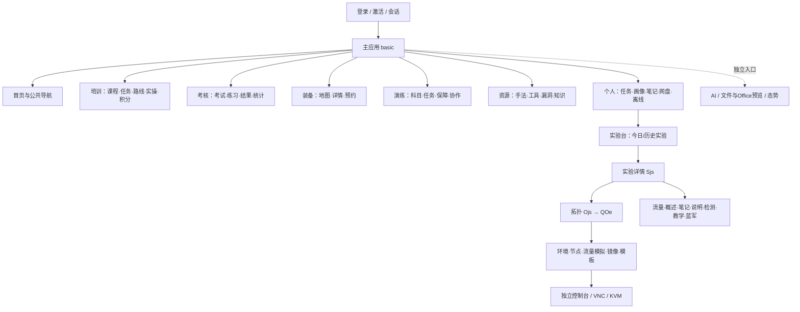
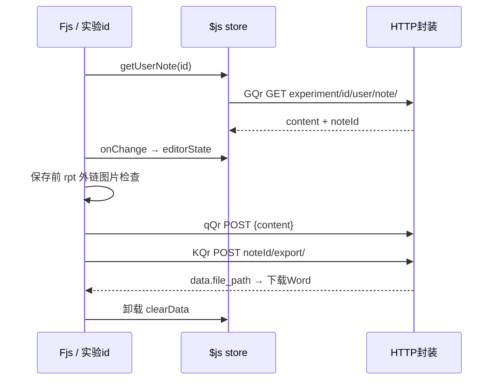

# 学员端页面功能与代码对照

审计日期：2026-10-19。覆盖 spec.md 的 **103 条用户故事、49 个功能组、104 条原始路由定义**。104 包含容器、默认子路由和重定向，并非独立页面数量。

## 阅读入口

- 需求基线：[spec.md](/Users/nanfugongmeiying/Desktop/project/lab/xueyuan-rebuild/docs/planning/spec.md)（唯一业务规格，分析目录不再保留副本）。
- 原站代码：[index-DECk1PRe.js](/Users/nanfugongmeiying/Desktop/project/lab/rea-analysis/xueyuan/artifact/index-DECk1PRe.js)；压缩产物无可维护源文件树，以原始符号和字符偏移定位。
- 可检索台账：[page-feature-code-map.json](/Users/nanfugongmeiying/Desktop/project/lab/xueyuan-rebuild/docs/planning/page-feature-code-map.json)，含全部路由、自有组件、定义位置、API 候选上下文与用户故事原文。
- 当前工程：[router.tsx](/Users/nanfugongmeiying/Desktop/project/lab/xueyuan-rebuild/apps/web/src/router.tsx)；状态说明：[implementation-status.md](/Users/nanfugongmeiying/Desktop/project/lab/xueyuan-rebuild/docs/implementation-status.md)。

本文件维护原站静态证据及审计时的工程代码定位；当前进度按 F 编号查询[实施计划](page-rebuild-implementation.md)。历史验证见[实施记录](../implementation-status.md)，协议与差异见对应架构契约。

证据分为：①路由原文可证的入口/组件；②组件或请求封装直接可见的静态行为；③spec要求；④仍未知的实际授权/运行契约。API 族匹配只帮助定位，不能证明对应页面实际调用、服务可用或账号有权限。

## 页面结构与共享边界



```tsx
<ExperimentDetail Sjs>                 // 原站，实验 id 上下文
  <Topology Ojs>                      // topo_id + test_task + task_type="6"
    <SharedTopology QOe>              // readOnly / shared / topo_edit
      <Graph>                         // 节点、端口、连线、分组与工具栏
      <EnvironmentAndNodeActions />   // 运行状态与设计数据分离
      <FlowPlaybackAndMirror />
  <Overview Djs />
  <Flow Rjs />
  <Notes Fjs>                         // $js store → GQr / qQr / KQr
    <RichText Ys />                   // 图片独立 ul.post 上传
  <Explanation Ujs />
  <Detection Wjs><DetectionType h8s /></Detection>
  <AttackTeaching x8s />
  <SimulatedBlueTeam _8s />
```

该树表达路由与业务边界，并非把未知的原始组件名称还原成了源码。环境、视频、答题、文件等共享功能需要保留课程/任务/路线/章节/实验/资源标识。

## 已有台账的串项与原站占位

| 项目                | 本次核对结果                                                                              | 原始字符定位                             |
| ------------------- | ----------------------------------------------------------------------------------------- | ---------------------------------------- |
| F030 任务中心       | Vjs 是“任务总览/任务列表”；画像四页签属于 J5s / F031。                                    | Vjs 12704253；J5s 12632566               |
| F032 我的笔记       | rjs 是“我的笔记/共享笔记”，使用 sfr 的笔记目录逻辑；原台账误写了网盘操作。                | rjs 12638360；sfr 12633060               |
| F033 网盘           | djs 是“公开资料/我的资料”；cjs 负责个人文件管理，ujs 负责公开资料。原台账误写实验列表。   | djs 12660657；cjs 12649480；ujs 12656272 |
| F034 实验列表       | xjs 使用今日/历史列表与 h2t；原台账仅填了元数据字段，遗漏列表管理行为。                   | xjs 12667965；h2t 12660906               |
| F042 流量/镜像/模板 | s$a 含 PCAP/脚本回放；镜像与模板有独立封装。课程打包/记录导入属于 F043。                  | s$a 7597792；O8s 12750607                |
| F025 演练统计排行   | P1s 与 D1s 仅返回“统计中心”“排行榜”文字；路由存在，原站提供的 bundle 中这两个入口为占位。 | P1s 11523210；D1s 11523249               |

以上修正已按 bundle 功能边界同步到台账。F025 的交付要求就是复刻两个占位入口，不新增 bundle 中不存在的统计、筛选或排行实现。

## 49 个功能组：页面、操作、状态与代码

### F001 公共 / 登录与会话

- **实施顺序**：正式业务的第一个实现单元；先独立达到“切片实现就绪”并完成验收，再扩展实验台与拓扑闭环。
- **入口**：/login。路由索引：R001。
- **功能**：账号、密码、验证码；登录、退出、当前用户、失效重登。
- **权限/状态**：账号状态；HTTP认证与应用Token分层。
- **原站代码**：`Ppi` @ `2425935`；`XKr` @ `1807635`；`p2n` @ `1807599`；`ZKr` @ `1807689`。
- **接口定位线索**：/api/front/login/; /api/front/logout/; /api/front/user/info/。
  - 词法候选示例（非调用链）：`/api/front/user/info/` @ `1807800`；`/api/front/login/` @ `1807642`。
- **验收**：错误凭据失败；有效账号进入；过期后回登录。
- **仍需补证**：验证码规则、Cookie/CSRF、会话有效期。
- **需求/阶段**：US 1, 2, 4, 10；P1。

### F002 公共 / 激活与入口守卫

- **入口**：/activate。路由索引：R104。
- **功能**：读取激活状态；显示激活流程；限制未登录/未激活访问。
- **权限/状态**：未激活与无权访问是不同状态。
- **原站代码**：`s7s` @ `12785085`。
- **接口定位线索**：/api/admin/system/active/。
  - 词法候选示例（非调用链）：`/api/admin/system/active/status/` @ `1811268`；`/api/admin/system/active/online/ ` @ `1811336`。
- **验收**：深链刷新、未登录、未激活分别有明确结果。
- **仍需补证**：真实授权权限、License 内容与当前线上响应；静态流程已补证。
- **需求/阶段**：US 5；P1。

### F003 公共 / 布局与首页

- **入口**：/basic/home。路由索引：R002、R003。
- **功能**：导航、首页概览、平台配置、用户菜单、主题消费、首次岗位与推荐设置。
- **权限/状态**：会话守卫；工具/漏洞配置未用于菜单过滤，不推测角色或启用开关。
- **原站代码**：`kpi` @ `2420771`；`lpi` @ `2375916`。
- **接口定位线索**：/api/admin/system/logo/; /api/admin/system/background/; /api/front/user/recommend/。
  - 词法候选示例（非调用链）：`/api/admin/system/logo/default/` @ `1807880`；`/api/admin/system/background/` @ `1807946`。
- **验收**：主入口可达；刷新保留当前路由。
- **仍需补证**：当前线上响应、角色矩阵；静态首页调用链已补证，未发现主题切换 UI。
- **需求/阶段**：US 6, 7；P1。

### F004 公共 / 通知、待办与收藏

- **入口**：公共导航及首页。路由索引：共享组件或公共导航内，无独立路由。
- **功能**：通知列表/详情/已读筛选；待办新增/完成/删除；收藏分页与资源入口。
- **权限/状态**：个人数据及批量对象范围。
- **原站代码**：`dl` @ `1836363`。
- **接口定位线索**：/api/front/user/notice/; /api/front/user/todo/; /api/front/user/collect/。
  - 词法候选示例（非调用链）：`/api/front/user/collect/?${Vt(e)}` @ `1810016`；`/api/front/user/todo/?${Vt(e)}` @ `1810085`。
- **验收**：状态变更后列表、数量与详情一致。
- **仍需补证**：字段与已读调用链已补证；待办批接口每次提交单项；收藏页无批量取消调用；真实权限与响应未联调，见 docs/planning/s04-implementation.md。
- **需求/阶段**：US 8, 9；P5。

### F005 培训 / 课程中心与课程详情

- **入口**：/basic/training/course。路由索引：R004、R005、R006、R007。
- **功能**：列表筛选；课程详情、目录、章节、资源、评论/推荐入口。
- **权限/状态**：can_enter、课程可见性/下线状态。
- **原站代码**：`lgi` @ `2459691`；`HEi` @ `3598190`。
- **接口定位线索**：/api/front/learn/task/self_study/open_courses/。
  - 词法候选示例（非调用链）：`/api/front/learn/task/self_study/open_courses/${e}/can_enter/` @ `1813396`；`/api/front/learn/task/self_study/open_courses/list/?` @ `1827782`。
- **验收**：可进入课程加载目录；不可进入时解释原因。
- **仍需补证**：筛选枚举、资源权限、评论是否可写。
- **需求/阶段**：US 36, 37, 42；P3。

### F006 培训 / 视频与学习进度

- **入口**：课程详情内部。路由索引：R007、R022。
- **功能**：播放、断点续播、章节切换、视频学习日志与进度上报；课程/章节开启分支。
- **权限/状态**：所属课程和章节；学习规则。
- **原站代码**：`HEi` @ `3598190`；`Gla` @ `5980075`。
- **接口定位线索**：/api/front/learn/task/self_study/open_courses/*/section/。
  - 词法候选示例（非调用链）：`/api/front/learn/task/self_study/open_courses/${e}/can_enter/` @ `1813396`；`/api/front/learn/task/self_study/open_courses/list/?` @ `1827782`。
- **验收**：播放/暂停/重开后的进度与后端一致。
- **仍需补证**：日志计算、心跳、拖动限制、重复上报处理；学习日志为写操作。
- **需求/阶段**：US 38, 39；P3。

### F007 培训 / 章节测验与实操检查点

- **入口**：课程详情内部。路由索引：R007、R022。
- **功能**：取题、作答、重置、提交；自测与检查点/flag流程。
- **权限/状态**：课程准入、次数及任务状态。
- **原站代码**：`HEi` @ `3598190`；`Gla` @ `5980075`。
- **接口定位线索**：/api/front/learn/task/self_study/open_courses/_/section/_/test/; operate/。
  - 词法候选示例（非调用链）：`/api/front/learn/task/self_study/open_courses/${e}/can_enter/` @ `1813396`；`/api/front/learn/task/self_study/open_courses/list/?` @ `1827782`。
- **验收**：正确/错误/未答及重复提交按真实规则处理。
- **仍需补证**：评分规则、题型、重试限制、环境依赖。
- **需求/阶段**：US 40, 41；P3。

### F008 培训 / 教学任务列表与详情

- **入口**：/basic/training/task。路由索引：R004、R008、R009、R010、R011。
- **功能**：按type查看任务、领取；教学任务详情、目录/课程、排行、实操/自测/关卡、作业、结果与进度。
- **权限/状态**：分配关系、时间、任务状态。
- **原站代码**：`K3i` @ `4082081`；`yla` @ `5925138`。
- **接口定位线索**：/api/front/learn/task/center_task/; teaching_task/; operate_task/。
  - 词法候选示例（非调用链）：`/api/front/learn/task/center_task/list/?` @ `1911572`；`/api/front/learn/task/center_task/?` @ `1911632`。
- **验收**：同一任务各入口进度一致。
- **仍需补证**：type枚举及各状态按钮规则。
- **需求/阶段**：US 43, 44, 45；P3。

### F009 培训 / 专题与教学结果

- **入口**：/basic/training/task/:id/course/:cid; teaching/result/:id。路由索引：R012、R013。
- **功能**：专题学习、附件/笔记关联、教学任务结果。
- **权限/状态**：任务、课程、章节的归属。
- **原站代码**：`wla` @ `5937123`；`Tla` @ `5953035`。
- **接口定位线索**：/api/front/learn/task/。
  - 词法候选示例（非调用链）：`/api/front/learn/task/center_task/teaching_task/${e}/` @ `1911808`；`/api/front/learn/task/center_task/teaching_task/${e.id}/course/?` @ `1911897`。
- **验收**：任务学习记录与结果页一致。
- **仍需补证**：专题与公开课程差异、计分结果。
- **需求/阶段**：US 44, 45；P3。

### F010 培训 / 虚拟科目

- **入口**：/basic/training/subject。路由索引：R004、R015、R016、R017。
- **功能**：科目列表、详情、进入训练；关联场景与题目。
- **权限/状态**：公开或分配科目及资源可用性。
- **原站代码**：`kmo` @ `9985694`；`mWn` @ `8141265`。
- **接口定位线索**：/api/front/rehearsal/subject_scene/（含Eb动态前缀）; /api/front/wqzb/test_task/。
  - 词法候选示例（非调用链）：`/api/front/wqzb/test_task/${e.id}/blue_team/?${Vt(e.filter)}` @ `1813477`；`/api/front/wqzb/test_task/${e.id}/blue_team/${e.blue_id}/init_data/` @ `1821246`。
- **验收**：列表到训练到结果形成可验证流程。
- **仍需补证**：科目类型、准入、完成条件。
- **需求/阶段**：US 46；P3。

### F011 培训 / 学习路线

- **入口**：/basic/training/studyRoute/:id; studyRoute/course/:id。路由索引：R004、R018、R019、R020、R021、R022。
- **功能**：路线详情、阶段、课程、虚拟科目与装备训练入口。
- **权限/状态**：路线分配、阶段依赖。
- **原站代码**：`Lla` @ `5962070`；`sBa` @ `8142405`；`umo` @ `9933060`；`Gla` @ `5980075`。
- **接口定位线索**：/api/front/guidance_control/learning_route/; train_route_task/。
  - 词法候选示例（非调用链）：`/api/front/guidance_control/learning_route/?${Vt(e)}` @ `1822762`；`/api/front/guidance_control/learning_route/${e}/` @ `1822828`。
- **验收**：路线与个人学习路线的进度一致。
- **仍需补证**：阶段解锁、课程/装备完成规则。
- **需求/阶段**：US 47, 48；P3。

### F012 培训 / 实操科目与任务

- **入口**：/basic/training/practiceSubject/:id。路由索引：R004、R023、R024、R072、R073。
- **功能**：实操详情、任务、题目、场景进入与完成。
- **权限/状态**：任务归属与状态、环境状态。
- **原站代码**：`_He` @ `9939935`；`wHe` @ `9983799`。
- **接口定位线索**：/api/front/guidance_control/training_task/; /api/front/wqzb/test_task/。
  - 词法候选示例（非调用链）：`/api/front/wqzb/test_task/${e.id}/blue_team/?${Vt(e.filter)}` @ `1813477`；`/api/front/wqzb/test_task/${e.id}/blue_team/${e.blue_id}/init_data/` @ `1821246`。
- **验收**：详情、训练、结果及再次进入一致。
- **仍需补证**：kind枚举、训练提交和判分。
- **需求/阶段**：US 49, 50；P3。

### F013 培训 / 积分排行

- **入口**：/basic/training/leaderboard。路由索引：R004、R014。
- **功能**：排行、范围与时间筛选（具体控件待核对）。
- **权限/状态**：可见统计范围。
- **原站代码**：`Dmo` @ `9999047`。
- **接口定位线索**：/api/front/learn/task/。
  - 词法候选示例（非调用链）：`/api/front/learn/task/center_task/teaching_task/${e.id}/rank/?` @ `1912010`；`/api/front/learn/task/center_task/league_board/user/rank_info/?${Vt(e)}` @ `1917288`。
- **验收**：显示后端排行和并列规则。
- **仍需补证**：积分口径、排序、分页。
- **需求/阶段**：US 51；P3。

### F014 考核 / 考核任务

- **入口**：/basic/exam/test。路由索引：R025、R026、R027、R028、R029。
- **功能**：任务列表/详情、准入、开始或继续考试。
- **权限/状态**：分配关系、考试时段、次数与完成状态。
- **原站代码**：`zmo` @ `10003288`；`rvo` @ `10031105`。
- **接口定位线索**：/api/front/exam/task/。
  - 词法候选示例（非调用链）：`/api/front/exam/task/assessment/?` @ `1931695`；`/api/front/exam/task/assessment/${e}/` @ `1931833`。
- **验收**：未开始/进行中/已交卷/无权访问均覆盖。
- **仍需补证**：迟到、开考、交卷、重考条件。
- **需求/阶段**：US 52, 53；P4。

### F015 考核 / 答题与场景题

- **入口**：/basic/exam/test/:id; /basic/exam/test/:id/scene/:sid。路由索引：R025、R028、R029、R030。
- **功能**：理论/实操/场景混合题型；切题、答案保存、关卡/Flag、报告上传、场景环境、交卷。
- **权限/状态**：题型、考试状态、答题权限。
- **原站代码**：`rvo` @ `10031105`；`lvo` @ `10067744`。
- **接口定位线索**：/api/front/exam/task/assessment/; assessment/env/run/。
  - 词法候选示例（非调用链）：`/api/front/exam/task/assessment/?` @ `1931695`；`/api/front/exam/task/assessment/${e}/` @ `1931833`。
- **验收**：刷新恢复；漏答提示；交卷后禁止继续写答案。
- **仍需补证**：倒计时、断线恢复、自动交卷、幂等规则。
- **需求/阶段**：US 54, 55, 56, 57, 58；P4。

### F016 考核 / 结果与统计排行

- **入口**：/basic/exam/test/result/:id; /basic/exam/statistics; /basic/exam/rank。路由索引：R025、R031、R032、R033。
- **功能**：结果、成绩、统计、排行榜。
- **权限/状态**：成绩发布、答案解析是否开放。
- **原站代码**：`gvo` @ `10076941`；`Tvo` @ `10095240`；`Ivo` @ `10097842`。
- **接口定位线索**：/api/front/exam/task/; /api/front/exam/ability_appraisa/。
  - 词法候选示例（非调用链）：`/api/front/exam/task/assessment/?` @ `1931695`；`/api/front/exam/task/assessment/${e}/` @ `1931833`。
- **验收**：结果与任务状态一致；未公布时不提前显示。
- **仍需补证**：可见时间、统计范围、评分规则。
- **需求/阶段**：US 59, 60；P4。

### F017 考核 / 题目练习

- **入口**：/basic/exam/practice; practice/scene/:sid。路由索引：R025、R034、R035。
- **功能**：题库筛选、作答、场景题、提交与反馈。
- **权限/状态**：练习与正式考试数据分离。
- **原站代码**：`g0o` @ `10162797`；`m0o` @ `10167819`。
- **接口定位线索**：/api/front/exam/task/。
  - 词法候选示例（非调用链）：`/api/front/exam/task/assessment/?` @ `1931695`；`/api/front/exam/task/assessment/${e}/` @ `1931833`。
- **验收**：练习结果不错误写入正式考试。
- **仍需补证**：题型范围、错题/收藏入口待核对。
- **需求/阶段**：US 61；P4。

### F018 装备 / 装备地图

- **入口**：/basic/practical/equipmap。路由索引：R036、R037、R038。
- **功能**：地图展示、定位/筛选和装备入口（交互细节待验证）。
- **权限/状态**：可见装备及位置范围。
- **原站代码**：`A0o` @ `10173141`。
- **接口定位线索**：/api/front/equipment/equip_map/info/。
  - 词法候选示例（非调用链）：`/api/front/equipment/equip_map/info/?${Vt(t)}` @ `8207056`。
- **验收**：地图与列表指向相同装备。
- **仍需补证**：地图底图资源、楼层/位置结构。
- **需求/阶段**：US 62；P4。

### F019 装备 / 装备列表与详情

- **入口**：/basic/practical/equipmanage。路由索引：R021、R036、R039、R040。
- **功能**：装备筛选、详情、开启训练、科目/任务、视频记录、自测、Flag、手工作业、日志、拓扑/视频/威胁模拟页签。
- **权限/状态**：可操作装备、可预约时段。
- **原站代码**：`umo` @ `9933060`；`w0o` @ `10175102`；`sJn` @ `9928213`。
- **接口定位线索**：/api/front/equipment/equip_practice/（含Jm动态前缀）; /api/front/equipment/。
- **验收**：同一装备在列表、详情、预约状态一致。
- **仍需补证**：列表真实数据来源及操作能力。
- **需求/阶段**：US 62, 63, 64, 65；P4。

### F020 装备 / 预约日历与记录

- **入口**：/basic/practical/equipreserve。路由索引：R036、R041。
- **功能**：日历、已预约、预约/取消、消息记录；禁用时段分支需验证权限。
- **权限/状态**：所属账号、时间冲突、禁用时段操作权限未知。
- **原站代码**：`z0o` @ `10213160`。
- **接口定位线索**：/api/front/equipment/equip_booking/。
  - 词法候选示例（非调用链）：`/api/front/equipment/equip_booking/message/${e.id}/?${Vt(e.filter)}` @ `8207116`；`/api/front/equipment/equip_booking/message/delete/` @ `8207197`。
- **验收**：冲突/过期/重复预约拒绝；成功后日历更新。
- **仍需补证**：审核、配额、取消期限、管理动作是否学员可见。
- **需求/阶段**：US 66, 67, 68；P4。

### F021 演练 / 公开科目与训练科目

- **入口**：/basic/skits/subject。路由索引：R042、R043、R044、R045、R046、R047、R055、R056。
- **功能**：按kind筛选、详情、开启、日志、任务、自测、视频、附件、答题/手工提交；应急流程图、攻击科目路线。
- **权限/状态**：科目类型、是否可进入。
- **原站代码**：`p1s` @ `11453005`；`L1s` @ `11520872`；`t1s` @ `11435105`；`l1s` @ `11443823`。
- **接口定位线索**：/api/front/rehearsal/${type}/; emergency_subject/_/flow_chat/; attack_subject/_/line/。
  - 词法候选示例（非调用链）：`/api/front/rehearsal/subject_scene/?` @ `5994056`；`/api/front/rehearsal/drill_task/${e}/` @ `5995688`。
- **验收**：不同kind分别验收，不只验收一种。
- **仍需补证**：kind枚举、训练要求及完成判据。
- **需求/阶段**：US 69, 70, 71；P4。

### F022 演练 / 演练任务

- **入口**：/basic/skits/task。路由索引：R042、R048、R049。
- **功能**：任务列表/详情、科目/子任务、视频/自测、作业/日志、席位、团队统计、演练评价、成果及外部环境。
- **权限/状态**：分配关系、任务类型与状态。
- **原站代码**：`Y0o` @ `10220127`；`UAs` @ `11413375`。
- **接口定位线索**：/api/front/rehearsal/drill_task/。
  - 词法候选示例（非调用链）：`/api/front/rehearsal/drill_task/${e}/` @ `5995688`；`/api/front/rehearsal/drill_task/${e.id}/subject/task/?${Vt(e.filter)}` @ `5995739`。
- **验收**：各类型任务入口和结果均可用。
- **仍需补证**：type枚举、成员席位权限、评价和成果编辑资格、任务阶段与提交条件。
- **需求/阶段**：US 72, 74；P4。

### F023 演练 / 保障任务

- **入口**：/basic/skits/commandsupport。路由索引：R042、R050、R051。
- **功能**：保障任务列表/详情、科目执行、消息、席位、成果/评价与任务状态。
- **权限/状态**：任务成员和保障操作边界。
- **原站代码**：`$1s` @ `11523287`；`H1s` @ `11567945`。
- **接口定位线索**：/api/front/rehearsal/safeguard_task/。
  - 词法候选示例（非调用链）：`/api/front/rehearsal/safeguard_task/${e}/` @ `5999071`；`/api/front/rehearsal/safeguard_task/${e.id}/subject/task/?${Vt(e.filter)}` @ `5999126`。
- **验收**：列表、详情与执行结果一致。
- **仍需补证**：成员席位、协作与消息发送资格、和演练任务关联；不据此发明指挥员角色。
- **需求/阶段**：US 73, 74；P4。

### F024 演练 / 实操训练

- **入口**：/basic/skits/practical。路由索引：R042、R052、R053、R054、R072、R073。
- **功能**：任务列表、详情、科目执行、题目/场景与结果。
- **权限/状态**：任务归属、实操状态。
- **原站代码**：`V1s` @ `11569787`；`_He` @ `9939935`；`wHe` @ `9983799`。
- **接口定位线索**：/api/front/guidance_control/training_task/; /api/front/wqzb/test_task/。
  - 词法候选示例（非调用链）：`/api/front/wqzb/test_task/${e.id}/blue_team/?${Vt(e.filter)}` @ `1813477`；`/api/front/wqzb/test_task/${e.id}/blue_team/${e.blue_id}/init_data/` @ `1821246`。
- **验收**：共享组件复用时保留不同业务参数。
- **仍需补证**：与培训实操入口差异。
- **需求/阶段**：US 49, 50；P4。

### F025 演练 / 统计与排行

- **入口**：/basic/skits/statistics; /basic/skits/rank。路由索引：R042、R057、R058。
- **功能**：统计中心与排行榜占位页面。
- **权限/状态**：沿用演练模块入口可见性。
- **原站代码**：`P1s` @ `11523210`；`D1s` @ `11523249`。
- **接口定位线索**：无；`P1s` 与 `D1s` 未发起统计或排行请求，附近 rehearsal API 不属于这两个占位组件的调用证据。
- **验收**：两个路由分别显示原 bundle 中的“统计中心”和“排行榜”文字。
- **仍需补证**：无；bundle 功能边界不扩展占位页面。
- **需求/阶段**：US 75；P4。

### F026 资源 / 手法库

- **入口**：/basic/resource/attack。路由索引：R059、R061、R062、R063。
- **功能**：树/分类、筛选、详情、战术展示；关联环境开启/延期/停止、检查/Flag/答案验证封装为候选。
- **权限/状态**：资源可见范围。
- **原站代码**：`q1s` @ `11571212`；`X1s` @ `11573554`。
- **接口定位线索**：/api/front/resources/attack/。
  - 词法候选示例（非调用链）：`/api/front/resources/attack/tree/` @ `1808213`；`/api/front/resources/attack/${e.id}/?` @ `1808260`。
- **验收**：树与详情同步，返回保持上下文。
- **仍需补证**：环境/练习是否在该详情入口开放、详情导航参数、关联内容。
- **需求/阶段**：US 76, 77；P5。

### F027 资源 / 工具库

- **入口**：/basic/resource/tool。路由索引：R059、R060、R064。
- **功能**：类别/类型、工具列表与详情；下载/使用动作需验证。
- **权限/状态**：查看、下载、接入工具分开核对。
- **原站代码**：`A4s` @ `12535467`。
- **接口定位线索**：/api/front/resources/tool/; /api/admin/resources/tool/。
  - 词法候选示例（非调用链）：`/api/admin/resources/tool/tool/settings/` @ `1809204`；`/api/front/resources/tool/category/` @ `1809279`。
- **验收**：列表、详情、允许的下载行为完整。
- **仍需补证**：工具配置与实际下载方式。
- **需求/阶段**：US 78；P5。

### F028 资源 / 漏洞库

- **入口**：/basic/resource/vuln。路由索引：R059、R065。
- **功能**：漏洞检索、筛选、详情及相关操作分支。
- **权限/状态**：可见记录与操作权限。
- **原站代码**：`S4s` @ `12544569`。
- **接口定位线索**：/api/admin/resources/vuln/。
  - 词法候选示例（非调用链）：`/api/admin/resources/vuln/settings/` @ `1809548`；`/api/admin/resources/vuln/classify/?nopage=1` @ `1809618`。
- **验收**：空结果、分页和详情一致。
- **仍需补证**：字段、筛选、详情呈现；admin路径不代表管理员权限。
- **需求/阶段**：US 79；P5。

### F029 资源 / 知识库

- **入口**：/basic/resource/knowledge。路由索引：R059、R066、R067、R068。
- **功能**：知识列表、检索、详情与内容呈现。
- **权限/状态**：知识发布/可见范围。
- **原站代码**：`T4s` @ `12548913`；`I4s` @ `12552179`。
- **接口定位线索**：/api/front/resources/knowledge/。
  - 词法候选示例（非调用链）：`/api/front/resources/knowledge/?` @ `1809892`；`/api/front/resources/knowledge/${e}/` @ `1809944`。
- **验收**：详情正确呈现且资源链接可用。
- **仍需补证**：内容格式和附件。
- **需求/阶段**：US 80；P5。

### F030 个人 / 任务中心

- **入口**：/basic/user/taskcenter。路由索引：R069、R070、R071、R072、R073。
- **功能**：任务总览、任务列表；汇总未完成任务并进入具体业务，含实操训练详情与科目入口。
- **权限/状态**：个人分配范围。
- **原站代码**：`Vjs` @ `12704253`；`_He` @ `9939935`；`wHe` @ `9983799`；`Hjs` @ `12699737`；`VNe` @ `10214250`。
- **接口定位线索**：/api/front/learn/task/; /api/front/user/todo/。
  - 词法候选示例（非调用链）：`/api/front/user/todo/?${Vt(e)}` @ `1810085`；`/api/front/user/todo/` @ `1810151`。
- **验收**：聚合入口与原业务入口状态一致。
- **仍需补证**：任务类型与其他任务中心关系。
- **需求/阶段**：US 81；P5。

### F031 个人 / 学习路线与学情画像

- **入口**：/basic/user/studypath; /basic/user/profile。路由索引：R069、R074、R075。
- **功能**：个人路线、进度、画像、能力/学习统计。
- **权限/状态**：当前用户及统计范围。
- **原站代码**：`D4s` @ `12560174`；`J5s` @ `12632566`。
- **接口定位线索**：/api/front/guidance_control/learning_route/; /api/front/user/learning_guide/。
  - 词法候选示例（非调用链）：`/api/front/user/learning_guide/statistics/` @ `1810532`；`/api/front/guidance_control/learning_route/?${Vt(e)}` @ `1822762`。
- **验收**：来源与统计口径可追溯。
- **仍需补证**：画像指标与图表数据契约。
- **需求/阶段**：US 82, 83；P5。

### F032 个人 / 我的笔记与共享笔记

- **入口**：/basic/user/note。路由索引：R069、R076。
- **功能**：我的笔记/共享笔记；默认训练归档与自定义目录；目录新建、重命名、删除；笔记新建、改名、删除、富文本/图片、保存重开、Word导出；默认归档分享与评分。
- **权限/状态**：type1–4 默认归档可查看共享和切换分享；type>4 自定义目录可新建笔记及改删目录；共享详情只读；真实服务端权限待验证。
- **原站代码**：`rjs` @ `12638360`；`sfr` @ `12633060`；`Ys` @ `3538482`。
- **接口定位线索**：/api/front/learn/task/my_notes/; /api/front/user/note/; /api/front/share/note/; /api/front/upload_image/。
  - 词法候选示例（非调用链）：`/api/front/learn/task/my_notes/folders/?${Vt(e)}` @ `1811521`；`/api/front/learn/task/my_notes/folders/create/` @ `1811605`。
- **验收**：默认/自定义目录门控正确；笔记保存重开及图片格式一致；分享、评分与Word产物分别验收。
- **仍需补证**：个人详情字段/空详情、分享可见范围与权限、目录级联删除、上传限制及Word真实正文/图片未实测；目录/共享读取类型已取样。
- **需求/阶段**：US 42, 84, 85, 86；P5。
- **补证**：[S10 静态契约与范围](../../.scratch/s10-content/analysis.md)。

### F033 个人 / 资源网盘

- **入口**：/basic/user/file。路由索引：R069、R077。
- **功能**：公开资料/我的资料；目录导航、新建文件夹、上传及进度、重命名、批量删除、分享、打包导出、预览/下载；各数据域权限分开核对。
- **权限/状态**：个人、平台、课程、公开资源分域。
- **原站代码**：`djs` @ `12660657`；`cjs` @ `12649480`；`ujs` @ `12656272`。
- **接口定位线索**：/api/front/learn/task/my_profile/files/; /api/front/open/resource_network_disk/; /api/front/learn/base/pan/; /api/front/base/pan/。
  - 词法候选示例（非调用链）：`/api/front/learn/base/pan/attachment/filelist/?${Vt(e)}` @ `1812815`；`/api/front/base/pan/platform/filelist/?${Vt(e)}` @ `1812954`。
- **验收**：路径导航、预览下载及错误处理正确。
- **仍需补证**：可写目录、配额、文件类型与重名规则。
- **需求/阶段**：US 42, 87, 88, 89；P5。

### F034 实验台 / 实验列表与管理

- **入口**：/basic/user/bench。路由索引：R069、R078、R079、R080。
- **功能**：今日/历史实验；搜索、分类与标签、分页；新建/编辑/删除、选择场景、进入详情；名称、描述、节点数、运行状态、释放时长与说明等字段按分支呈现。
- **权限/状态**：本人/共享/受限实验；类型与配额未知。
- **原站代码**：`xjs` @ `12667965`；`h2t` @ `12660906`。
- **接口定位线索**：/api/front/simulation/experiment/; /api/front/base/tag/。
  - 词法候选示例（非调用链）：`/api/front/simulation/experiment/?${Vt(e)}` @ `1817747`；`/api/front/simulation/experiment/more/?${Vt(e)}` @ `1817803`。
- **验收**：创建→编辑→重开；无权编辑拒绝。
- **仍需补证**：所有权、发布方式、删除影响范围。
- **需求/阶段**：US 11, 12, 13, 14, 15；P1。

### F035 实验台 / 场景概述与说明

- **入口**：/basic/user/bench/experiment/:id/overview; explain。路由索引：R080、R083、R085。
- **功能**：实验名称描述、标签、统计、说明编辑（按分支）。
- **权限/状态**：所有者与只读、锁定状态。
- **原站代码**：`Djs` @ `12692534`；`Ujs` @ `12698055`。
- **接口定位线索**：/api/front/simulation/experiment/。
  - 词法候选示例（非调用链）：`/api/front/simulation/experiment/?${Vt(e)}` @ `1817747`；`/api/front/simulation/experiment/more/?${Vt(e)}` @ `1817803`。
- **验收**：修改重开一致；只读不出现可写操作。
- **仍需补证**：概述和说明的实际字段及可写条件。
- **需求/阶段**：US 15, 31；P2。

### F036 实验台 / 场景拓扑编辑

- **入口**：/basic/user/bench/experiment/:id/scene。路由索引：R080、R081。
- **功能**：设备面板、图元、拖入、端口连线、分组、框选、缩放平移、配置、保存、节点模板复用、PNG/SVG视觉导出。
- **权限/状态**：readOnly、shared、lock、topo_edit、task_type组合。
- **原站代码**：`Ojs` @ `12682300`；`QOe` @ `8018585`；`gVn` @ `6807362`；`j3a` @ `6893971`。
- **接口定位线索**：/api/front/topo/; /api/front/node/; /api/topo/。
  - 词法候选示例（非调用链）：`/api/front/topo/template/${e}/` @ `6074233`；`/api/front/topo/template/${e}/?detail=1` @ `6074277`。
- **验收**：节点/边/位置/配置保存后重开一致。
- **仍需补证**：其他入口能力裁剪、资源上限、在线数据契约；实验task_type=6无可达拓扑文件导入，范围依据见[S06记录](s06-implementation.md)。
- **需求/阶段**：US 16, 17, 18, 19, 20, 21, 22, 23, 24, 25；P1。

### F037 实验台 / 环境与节点生命周期

- **入口**：场景拓扑内部。路由索引：R080、R081。
- **功能**：启动/停止/释放/延期、节点状态、控制台、配置与资源操作。
- **权限/状态**：运行状态、配额、任务与节点归属。
- **原站代码**：`Ojs` @ `12682300`；`QOe` @ `8018585`。
- **接口定位线索**：/api/front/env/; /api/admin/wqzb/node_instance/; /api/front/topo/node_run/。
  - 词法候选示例（非调用链）：`/api/front/env/start/` @ `1808423`；`/api/front/env/delay/${e.run_id}/` @ `1808487`。
- **验收**：异步状态可恢复；失败不伪报成功。
- **仍需补证**：真实状态枚举、运行中可编辑规则、失败恢复。
- **需求/阶段**：US 26, 27, 28；P2。

### F038 实验台 / 流量监控与捕获

- **入口**：/basic/user/bench/experiment/:id/flow。路由索引：R080、R082。
- **功能**：捕获任务/记录、开始/停止捕获、删除记录、文件获取。
- **权限/状态**：运行环境与允许捕获的节点/链路。
- **原站代码**：`Rjs` @ `12686391`。
- **接口定位线索**：/api/front/wqzb/test_task/; /api/front/scene/record/; /api/admin/flow/。
  - 词法候选示例（非调用链）：`/api/front/scene/record/start/` @ `1828436`；`/api/front/scene/record/status/` @ `1828503`。
- **验收**：捕获状态与记录一致；离页资源按规则清理。
- **仍需补证**：PCAP下载、轮询及资源释放。
- **需求/阶段**：US 29, 30；P2。

### F039 实验台 / 场景笔记

- **入口**：/basic/user/bench/experiment/:id/notes。路由索引：R080、R084。
- **功能**：读取、编辑、保存、图片上传、Word导出。
- **权限/状态**：实验/笔记归属及只读条件待验证。
- **原站代码**：`Fjs` @ `12696999`；`$js` @ `12696103`；`GQr` @ `1818284`；`qQr` @ `1818346`；`KQr` @ `1818439`；`Ys` @ `3538482`。
- **接口定位线索**：/api/admin/simulation/experiment/*/user/note/; /api/front/upload_image/。
  - 词法候选示例（非调用链）：`${e.url||"/api/front/user/note/"}` @ `1811931`；`${e.url||"/api/front/user/note/"}${e.id}/` @ `1812028`。
- **验收**：保存重开一致；导出内容与图片有效。
- **仍需补证**：有效id与空字符串content已真实只读确认；真实保存、图片上传权限与Word实际产物未验证。
- **需求/阶段**：US 32, 33；P2。

### F040 实验台 / 检测手段

- **入口**：/basic/user/bench/experiment/:id/detection/:type。路由索引：R080、R086、R087。
- **功能**：按类型选择工具/配置/执行/查看结果的流程逐项恢复。
- **权限/状态**：检测类型、环境及操作权。
- **原站代码**：`h8s` @ `12722849`；`Wjs` @ `12704645`。
- **接口定位线索**：/api/front/wqzb/detection_front/; /api/front/wqzb/tool/。
  - 词法候选示例（非调用链）：`/api/front/wqzb/tool/version/cascade/` @ `1822386`；`/api/front/wqzb/detection_front/tools/` @ `1829358`。
- **验收**：每个开放类型分别验收。
- **仍需补证**：type枚举、任务状态与输出格式。
- **需求/阶段**：US 34；P2。

### F041 实验台 / 攻击教学与模拟蓝军

- **入口**：/basic/user/bench/experiment/:id/attackteaching; simulate。路由索引：R080、R088、R089。
- **功能**：教学内容/任务、蓝军节点及工具配置、运行与结果（操作细节待核对）。
- **权限/状态**：角色/工具能力、实验状态和可用资源。
- **原站代码**：`x8s` @ `12736676`；`_8s` @ `12737090`；`p8s` @ `12727493`；`g8s` @ `12728627`；`v8s` @ `12729839`；`y8s` @ `12731649`；`A8s` @ `12732868`。
- **接口定位线索**：/api/front/wqzb/simulated_blue_team/; /api/front/wqzb/test_task/。
  - 词法候选示例（非调用链）：`/api/front/wqzb/test_task/${e.id}/blue_team/?${Vt(e.filter)}` @ `1813477`；`/api/front/wqzb/test_task/${e.id}/blue_team/${e.blue_id}/init_data/` @ `1821246`。
- **验收**：配置与结果可追踪；执行在测试范围开放后联调。
- **仍需补证**：调用链、执行条件、任务终止与结果。
- **需求/阶段**：US 35；P2。

### F042 实验台 / 流量模拟、镜像与模板

- **入口**：共享拓扑组件内部。路由索引：R080、R081。
- **功能**：流量模拟、PCAP/脚本回放、流量镜像、按入口裁剪的模板；实验task_type=6可达节点模板保存/复用/删除，完整拓扑模板与拓扑文件导入不可达；blocking_template为流量拦截策略而非分块拓扑。
- **权限/状态**：具体入口、task_type、资源类型与权限分支。
- **原站代码**：`Ojs` @ `12682300`；`QOe` @ `8018585`；`s$a` @ `7597792`；`HWt` @ `7599146`。
- **接口定位线索**：/api/topo/; /api/front/topo/template/; /api/front/topo/blocking_template/; /api/front/scene/; /api/front/node/template/; /api/front/node/list/。
  - 词法候选示例（非调用链）：`/api/front/scene/${e.id}/backgroud_flow/?${Vt(e.filter)}` @ `1828767`；`/api/front/scene/${e.id}/backgroud_flow/${e.node_id}/config/?${Vt(e.filter)}` @ `1828837`。
- **验收**：按真实入口逐项确认并记录不适用原因。
- **仍需补证**：其他入口模板能力、流量与镜像的配置及状态契约；实验入口裁剪依据见[S06记录](s06-implementation.md)。
- **需求/阶段**：US 16, 17, 18, 19, 20, 21, 22, 23, 29；P2。

### F043 个人 / 离线学习

- **入口**：/basic/user/offline。路由索引：R069、R090。
- **功能**：课程包生成/列表/删除、记录、统计、应用列表。
- **权限/状态**：本人离线包与同步范围。
- **原站代码**：`O8s` @ `12750607`。
- **接口定位线索**：/api/front/offline/。
  - 词法候选示例（非调用链）：`/api/front/offline/course/package/?` @ `1827612`；`/api/front/offline/course/package/` @ `1827689`。
- **验收**：生成/下载/学习记录回传流程有真实证据。
- **仍需补证**：离线客户端依赖、打包下载、日志回传协议。
- **需求/阶段**：US 90, 91；P5。

### F044 个人 / 个人中心与密码

- **入口**：/basic/personal/:type。路由索引：R091。
- **功能**：信息查看/编辑、密码修改及type对应页签。
- **权限/状态**：当前用户及字段可编辑性。
- **原站代码**：`tgi` @ `2451694`。
- **接口定位线索**：/api/front/user/info/; /api/front/user/password/。
  - 词法候选示例（非调用链）：`/api/front/user/info/` @ `1807800`；`/api/front/user/password/` @ `1807729`。
- **验收**：非法字段拒绝；成功状态重开保留。
- **仍需补证**：真实密码强度与错误枚举、服务端主动失效策略未联调；type、资料字段和改密后主动退出调用链见[个人账号契约](../architecture/personal-account.md)。
- **需求/阶段**：US 92；P5。

### F045 独立入口 / AI助手

- **入口**：/ai。路由索引：R092。
- **功能**：助手列表、会话创建/历史/重命名/删除、消息与流式输出、中断。
- **权限/状态**：助手可见性、会话所有权、额度未知。
- **原站代码**：`YWs` @ `13320694`；`$Nn` @ `2369376`。
- **接口定位线索**：/api/front/ai/; /api/front/resources/aichat/。
  - 词法候选示例（非调用链）：`/api/front/ai/applications/` @ `1808010`；`/api/front/ai/application/token/` @ `1808073`。
- **验收**：流式输出/中断/重开历史一致。
- **仍需补证**：流式协议、附件、消息提交接口与断线行为。
- **需求/阶段**：US 93, 94；P6。

### F046 独立入口 / VNC、KVM与控制台

- **入口**：/vnccontrol/:type/:id; /kvmvnc/:type/:id/:name; /controlpanel/:system/:id; /mpst/fullscreen/:type/:id。路由索引：R094、R095、R096、R097。
- **功能**：会话连接、输入、全屏、尺寸同步、重连与关闭。
- **权限/状态**：节点归属、运行状态、会话授权。
- **原站代码**：`I8s` @ `12752988`；`D8s` @ `12756521`；`X8s` @ `12777608`；`Z8s` @ `12781711`。
- **接口定位线索**：待核对控制台HTTP/WS会话契约。
  - 词法候选示例（非调用链）：`/api/front/topo/node_run/${e}/novnc/` @ `6081783`。
- **验收**：真实测试节点连通、断线重连、过期票据拒绝。
- **仍需补证**：WebSocket地址、票据、代理与浏览器要求。
- **需求/阶段**：US 28, 95；P2。

### F047 独立入口 / 文件与Office预览

- **入口**：/fileView/:id; /office/viewer。路由索引：R093、R101。
- **功能**：文件加载、内容/目录、Office服务配置与失败提示。
- **权限/状态**：原文件访问权与预览授权。
- **原站代码**：`QWs` @ `13320916`；`KWs` @ `13320274`。
- **接口定位线索**：文件接口及logoSetting.onlyoffice_url等配置。
- **验收**：无权限或文件失效时不展示残留内容。
- **仍需补证**：预览服务、文件签名、跨域与格式范围。
- **需求/阶段**：US 87, 88, 89；P5。

### F048 独立入口 / 蓝军、防御、导调态势

- **入口**：/bluessituation/_; /defensive/_; /leadingtone/*。路由索引：R098、R099、R100。
- **功能**：场景关联、态势指标、节点/事件/流量、刷新与钻取（细节待验证）。
- **权限/状态**：场景、角色视角、任务与资源关系。
- **原站代码**：`u7s` @ `12793691`；`GWs` @ `13302767`；`qWs` @ `13309900`。
- **接口定位线索**：待从独立组件定位具体HTTP/WS接口。
  - 词法候选示例（非调用链）：`/api/front/wqzb/test_task/${e.id}/blue_team/${e.blue_id}/init_situation_node/?${Vt(e.search)}` @ `1815128`；`/api/front/wqzb/test_task/${e.id}/blue_team/${e.blue_id}/init_situation_node/` @ `1815235`。
- **验收**：同一场景不同视角按权限展示。
- **仍需补证**：静态展示/实时数据区别；真实角色名称未知。
- **需求/阶段**：US 96；P6。

### F049 公共 / 异常、深链与生命周期

- **入口**：/; *; 全部页面。路由索引：R002、R102、R103。
- **功能**：默认跳转、404、加载/空/失败、取消请求、定时器清理、未保存离页处理。
- **权限/状态**：401/403、禁用/锁定/不可用状态。
- **原站代码**：`e7s` @ `12781892`；`Ae` @ `1805706`；`h2n` @ `1807551`。
- **接口定位线索**：通用客户端与各模块接口。
- **验收**：刷新深链、断网、拒绝访问、重复点击均验收。
- **仍需补证**：后续业务逐切片验收生命周期，不把公共基础当全站完成。
- **需求/阶段**：US 3, 4, 5, 10, 24, 25, 97, 98, 99, 100, 101, 102, 103；P1。

## 三条关键链路

### 实验设计与运行

```text
列表 xjs → h2t → jQr / zQr / UQr / D2n / HQr
  打开实验 → Sjs → 实验上下文 ZK
    scene → Ojs → QOe(id=topo_id, testId=test_task, task_type="6")
      编辑节点/端口/连线/分组 → 拓扑保存契约 → 重新读取并比较
      启停/释放/延期 → 环境与节点状态 → 轮询/失败恢复 → 控制台
    切换实验/离页 → 清理旧选择、缓存、请求、定时器和连接
```

前半段入口与封装静态可见；保存完整格式、运行枚举、权限与后端持久化结果仍待验证。

### 场景笔记（静态链路可直接核对）



图片经 Ys → ul.post `/api/front/upload_image/`，FormData 包含 image、mode="scene"、可选 uuid，带 CSRF；不应假定经过 Ae 的 Token 拦截器。导出成功仍需核对实际 Word 产物与图片。

### 课程、考试与共享训练上下文

```text
公开课程 HEi ──────────── 课程/章节
教学任务 yla → wla ───── 任务/课程/章节
学习路线 Lla → Gla ───── 路线任务/课程/章节
实操 _He → wHe ───────── 任务/科目/资源（多个路由复用同一组件）
考核 rvo → lvo ───────── 考试/答题尝试/场景
练习 g0o → m0o ───────── 练习上下文
  各自保存视频日志、答案、Flag、作业与结果，不能跨上下文写入
```

## 当前重建工程代码对应关系

原站的压缩组件符号不会直接对应 React 新工程中的同名文件。以下仅列现有代码，未创建的业务文件不猜路径。

| 功能                         | 当前文件与符号                                                                                                                                                                                                                                      | 实际边界                                                           |
| ---------------------------- | --------------------------------------------------------------------------------------------------------------------------------------------------------------------------------------------------------------------------------------------------- | ------------------------------------------------------------------ |
| 应用启动与查询上下文         | [main.tsx](/Users/nanfugongmeiying/Desktop/project/lab/xueyuan-rebuild/apps/web/src/main.tsx:2)；[App.tsx](/Users/nanfugongmeiying/Desktop/project/lab/xueyuan-rebuild/apps/web/src/App.tsx:31)                                                     | 挂载 RouterProvider、QueryClientProvider；无真实登录会话           |
| 路由、能力菜单、深链与错误页 | [router.tsx](/Users/nanfugongmeiying/Desktop/project/lab/xueyuan-rebuild/apps/web/src/router.tsx:19)；[identity.ts](/Users/nanfugongmeiying/Desktop/project/lab/xueyuan-rebuild/apps/web/src/identity.ts:15)                                        | 只含工程样例入口；能力是模拟集合，未接后端账号权限                 |
| 未保存离页提示               | [router.tsx](/Users/nanfugongmeiying/Desktop/project/lab/xueyuan-rebuild/apps/web/src/router.tsx:157)；[app-shell.test.tsx](/Users/nanfugongmeiying/Desktop/project/lab/xueyuan-rebuild/apps/web/src/app-shell.test.tsx:4)                          | 验证草稿导航阻止；未覆盖正式拓扑保存失败/恢复                      |
| 请求、错误、认证接缝         | [client.ts](/Users/nanfugongmeiying/Desktop/project/lab/xueyuan-rebuild/apps/web/src/api/client.ts:155)；[index.ts](/Users/nanfugongmeiying/Desktop/project/lab/xueyuan-rebuild/apps/web/src/api/index.ts:7)                                        | 原生 fetch 边界；requestPolicy.apply 为空，Token/CSRF/登录尚未实现 |
| 接口诊断与模拟响应           | [diagnostics-page.tsx](/Users/nanfugongmeiying/Desktop/project/lab/xueyuan-rebuild/apps/web/src/diagnostics-page.tsx:16)；[handlers.ts](/Users/nanfugongmeiying/Desktop/project/lab/xueyuan-rebuild/apps/web/src/mocks/handlers.ts:4)               | 技术样例与 MSW，不是业务接口已接通                                 |
| 表格、筛选、分页与嵌套表单   | [data-diagnostics.tsx](/Users/nanfugongmeiying/Desktop/project/lab/xueyuan-rebuild/apps/web/src/data-diagnostics.tsx:193)；[samples.ts](/Users/nanfugongmeiying/Desktop/project/lab/xueyuan-rebuild/apps/web/src/api/samples.ts:3)                  | 服务端模式的模拟资源样例；不等于课程、装备或实验管理页             |
| 拓扑编辑样例                 | [TopologyPage.tsx](/Users/nanfugongmeiying/Desktop/project/lab/xueyuan-rebuild/apps/web/src/topology/TopologyPage.tsx:149)；[editor-store.ts](/Users/nanfugongmeiying/Desktop/project/lab/xueyuan-rebuild/apps/web/src/topology/editor-store.ts:11) | 节点名称编辑、拖动、显示端口/分组、画布缩放；不具备完整业务编辑器  |
| X6格式适配                   | [x6-adapter.ts](/Users/nanfugongmeiying/Desktop/project/lab/xueyuan-rebuild/apps/web/src/topology/x6-adapter.ts:104)；[sample.ts](/Users/nanfugongmeiying/Desktop/project/lab/xueyuan-rebuild/apps/web/src/topology/sample.ts:3)                    | 保留未知图元/字段，转换节点/边/分组/端口/旋转；真实样本兼容待验    |
| 模拟保存并重开               | [TopologyPage.tsx](/Users/nanfugongmeiying/Desktop/project/lab/xueyuan-rebuild/apps/web/src/topology/TopologyPage.tsx:192)；[x6-adapter.ts](/Users/nanfugongmeiying/Desktop/project/lab/xueyuan-rebuild/apps/web/src/topology/x6-adapter.ts:228)    | 只在内存执行 fromX6Graph(toX6Graph(editor))；未请求后端、未持久化  |
| 浏览器流程验证               | [smoke.spec.ts](/Users/nanfugongmeiying/Desktop/project/lab/xueyuan-rebuild/tests/browser/smoke.spec.ts:19)；[playwright.config.ts](/Users/nanfugongmeiying/Desktop/project/lab/xueyuan-rebuild/playwright.config.ts:3)                             | 覆盖工程样例，未验收 spec 全站业务                                 |

进一步定位关键行为：

| 现有函数                  | 代码位置                                                                                                                                         | 可核对行为                                                                        |
| ------------------------- | ------------------------------------------------------------------------------------------------------------------------------------------------ | --------------------------------------------------------------------------------- |
| `DraftPage`               | [apps/web/src/router.tsx](/Users/nanfugongmeiying/Desktop/project/lab/xueyuan-rebuild/apps/web/src/router.tsx:157)                               | 仅示例草稿的导航阻止，不负责实验草稿持久化                                        |
| `mockIdentity / can`      | [apps/web/src/identity.ts](/Users/nanfugongmeiying/Desktop/project/lab/xueyuan-rebuild/apps/web/src/identity.ts:15)                              | 模拟能力；菜单过滤没有替代路由守卫和后端鉴权                                      |
| `requestPolicy`           | [apps/web/src/api/index.ts](/Users/nanfugongmeiying/Desktop/project/lab/xueyuan-rebuild/apps/web/src/api/index.ts:5)                             | apply 为空，真实 Token / CSRF 接入尚未实现                                        |
| `createApiClient`         | [apps/web/src/api/client.ts](/Users/nanfugongmeiying/Desktop/project/lab/xueyuan-rebuild/apps/web/src/api/client.ts:155)                         | Fetch、JSON/FormData、取消/超时、HTTP/业务/网络错误归一化及多种响应格式           |
| `DiagnosticsPage`         | [apps/web/src/diagnostics-page.tsx](/Users/nanfugongmeiying/Desktop/project/lab/xueyuan-rebuild/apps/web/src/diagnostics-page.tsx:32)            | 成功/空/错误/慢请求/超时/取消等诊断                                               |
| `DataDiagnosticsPage`     | [apps/web/src/data-diagnostics.tsx](/Users/nanfugongmeiying/Desktop/project/lab/xueyuan-rebuild/apps/web/src/data-diagnostics.tsx:193)           | 非 DEV 或关闭 MSW 时不发送样本读写                                                |
| `SampleEditor`            | [apps/web/src/data-diagnostics.tsx](/Users/nanfugongmeiying/Desktop/project/lab/xueyuan-rebuild/apps/web/src/data-diagnostics.tsx:50)            | Zod 校验、TanStack Form、嵌套别名与服务端字段错误；保存后刷新样本查询             |
| `applyLabel`              | [apps/web/src/topology/TopologyPage.tsx](/Users/nanfugongmeiying/Desktop/project/lab/xueyuan-rebuild/apps/web/src/topology/TopologyPage.tsx:180) | 选中节点后修改名称，trim 后只更新编辑态                                           |
| `saveAndReopen`           | [apps/web/src/topology/TopologyPage.tsx](/Users/nanfugongmeiying/Desktop/project/lab/xueyuan-rebuild/apps/web/src/topology/TopologyPage.tsx:192) | 只做内存格式回环，没有 API 或本地持久化                                           |
| `fromX6Graph / toX6Graph` | [apps/web/src/topology/x6-adapter.ts](/Users/nanfugongmeiying/Desktop/project/lab/xueyuan-rebuild/apps/web/src/topology/x6-adapter.ts:104)       | 节点、端口、分组、坐标、尺寸、角度、边路由与未知字段兼容；非法引用/图元保留并报告 |
| `浏览器 smoke 流程`       | [tests/browser/smoke.spec.ts](/Users/nanfugongmeiying/Desktop/project/lab/xueyuan-rebuild/tests/browser/smoke.spec.ts:19)                        | 6 项初始化流程覆盖外壳、诊断、错误恢复、表格、表单、图样例；未覆盖正式业务        |

拓扑样例没有设备库、节点新增与完整连线提交、设备业务配置、图元工具栏、真实环境启停或控制台。测试通过记录引用既有实施状态，本次只做文档及索引校验，没有重新运行应用测试。

正式业务缺口：登录/验证码/会话、实验管理与持久化、设备库与新增连线/配置、只读共享锁定、环境运行、笔记/文件、全部课程考试装备演练资源个人功能、AI/控制台/态势；诊断页和内存样例均不能抵扣这些验收要求。

## 103 条需求覆盖索引

US100–103 是接入模式可识别、覆盖台账、阶段交付声明、视觉与逻辑分离等全局要求，归 F049 便于追踪，但约束所有模块。US97–99 的错误、状态隔离与清理也适用于全站。

| 用户故事 | 对应功能组       | 规格原文                                                                                                                                                                                                                                                                                         |
| -------- | ---------------- | ------------------------------------------------------------------------------------------------------------------------------------------------------------------------------------------------------------------------------------------------------------------------------------------------ |
| US001    | F001             | [As a learner, I want to sign in with the required account fields and verification challenge, so that I can access the platform using my existing account.](/Users/nanfugongmeiying/Desktop/project/lab/xueyuan-rebuild/docs/planning/spec.md:26)                                                |
| US002    | F001             | [As a learner, I want to receive actionable validation and authentication errors, so that I can correct failed sign-in attempts.](/Users/nanfugongmeiying/Desktop/project/lab/xueyuan-rebuild/docs/planning/spec.md:27)                                                                          |
| US003    | F049             | [As a learner, I want to open an authorized page directly and refresh it, so that I can resume work through bookmarked links.](/Users/nanfugongmeiying/Desktop/project/lab/xueyuan-rebuild/docs/planning/spec.md:28)                                                                             |
| US004    | F001, F049       | [As a learner, I want to have expired sessions handled explicitly, so that I can reauthenticate without mistaking stale data for current results.](/Users/nanfugongmeiying/Desktop/project/lab/xueyuan-rebuild/docs/planning/spec.md:29)                                                         |
| US005    | F002, F049       | [As a learner, I want to distinguish inactive-account, forbidden-resource and signed-out states, so that I understand why an action is unavailable.](/Users/nanfugongmeiying/Desktop/project/lab/xueyuan-rebuild/docs/planning/spec.md:30)                                                       |
| US006    | F003             | [As a learner, I want to see the navigation and platform configuration applicable to my account, so that I can find the features available to me.](/Users/nanfugongmeiying/Desktop/project/lab/xueyuan-rebuild/docs/planning/spec.md:31)                                                         |
| US007    | F003             | [As a learner, I want to view my homepage recommendations and learning overview, so that I can choose my next activity.](/Users/nanfugongmeiying/Desktop/project/lab/xueyuan-rebuild/docs/planning/spec.md:32)                                                                                   |
| US008    | F004             | [As a learner, I want to view notices, inspect details and mark them read, so that I can keep track of relevant updates.](/Users/nanfugongmeiying/Desktop/project/lab/xueyuan-rebuild/docs/planning/spec.md:33)                                                                                  |
| US009    | F004             | [As a learner, I want to manage my permitted to-do items and favorites, so that I can organize ongoing work.](/Users/nanfugongmeiying/Desktop/project/lab/xueyuan-rebuild/docs/planning/spec.md:34)                                                                                              |
| US010    | F001, F049       | [As a learner, I want to sign out and clear account-specific client state, so that another session does not inherit my information.](/Users/nanfugongmeiying/Desktop/project/lab/xueyuan-rebuild/docs/planning/spec.md:35)                                                                       |
| US011    | F034             | [As a learner, I want to browse current and historical experiments with supported filters, so that I can find the experiment I need.](/Users/nanfugongmeiying/Desktop/project/lab/xueyuan-rebuild/docs/planning/spec.md:39)                                                                      |
| US012    | F034             | [As an authorized experiment editor, I want to create an experiment from the permitted scene and configuration, so that I can prepare a training workspace.](/Users/nanfugongmeiying/Desktop/project/lab/xueyuan-rebuild/docs/planning/spec.md:40)                                               |
| US013    | F034             | [As an authorized experiment editor, I want to edit experiment metadata, tags and supported release settings, so that I can keep the experiment configuration accurate.](/Users/nanfugongmeiying/Desktop/project/lab/xueyuan-rebuild/docs/planning/spec.md:41)                                   |
| US014    | F034             | [As an authorized experiment editor, I want to delete only experiments I am allowed to delete with the documented effects, so that I can manage obsolete experiments.](/Users/nanfugongmeiying/Desktop/project/lab/xueyuan-rebuild/docs/planning/spec.md:42)                                     |
| US015    | F034, F035       | [As a learner, I want to open experiment details and its available subpages, so that I can work within one consistent experiment context.](/Users/nanfugongmeiying/Desktop/project/lab/xueyuan-rebuild/docs/planning/spec.md:43)                                                                 |
| US016    | F036, F042       | [As an authorized topology editor, I want to browse available devices and place nodes on the canvas, so that I can construct a scene.](/Users/nanfugongmeiying/Desktop/project/lab/xueyuan-rebuild/docs/planning/spec.md:44)                                                                     |
| US017    | F036, F042       | [As an authorized topology editor, I want to move nodes and navigate the canvas through zoom and pan, so that I can arrange and inspect the topology.](/Users/nanfugongmeiying/Desktop/project/lab/xueyuan-rebuild/docs/planning/spec.md:45)                                                     |
| US018    | F036, F042       | [As an authorized topology editor, I want to connect valid device ports and configure links, so that I can express the intended network structure.](/Users/nanfugongmeiying/Desktop/project/lab/xueyuan-rebuild/docs/planning/spec.md:46)                                                        |
| US019    | F036, F042       | [As an authorized topology editor, I want to inspect and edit supported device and node properties, so that I can configure the scene correctly.](/Users/nanfugongmeiying/Desktop/project/lab/xueyuan-rebuild/docs/planning/spec.md:47)                                                          |
| US020    | F036, F042       | [As an authorized topology editor, I want to select multiple objects and use supported grouping, resizing and rotation, so that I can manipulate complex scenes efficiently.](/Users/nanfugongmeiying/Desktop/project/lab/xueyuan-rebuild/docs/planning/spec.md:48)                              |
| US021    | F036, F042       | [As an authorized topology editor, I want to use supported annotations, drawing elements and topology templates, so that I can document and reuse scene designs.](/Users/nanfugongmeiying/Desktop/project/lab/xueyuan-rebuild/docs/planning/spec.md:49)                                          |
| US022    | F036, F042       | [As an authorized topology editor, I want to use context menus and toolbar actions available for the selected object, so that I can perform the correct operation in context.](/Users/nanfugongmeiying/Desktop/project/lab/xueyuan-rebuild/docs/planning/spec.md:50)                             |
| US023    | F036, F042       | [As an authorized topology editor, I want to save a topology and reopen its nodes, links, positions and configuration, so that I can trust that my work is persisted.](/Users/nanfugongmeiying/Desktop/project/lab/xueyuan-rebuild/docs/planning/spec.md:51)                                     |
| US024    | F036, F049       | [As an authorized topology editor, I want to retain unsaved edits when saving fails and receive an unsaved-work warning when appropriate, so that I can recover from interruption.](/Users/nanfugongmeiying/Desktop/project/lab/xueyuan-rebuild/docs/planning/spec.md:52)                        |
| US025    | F036, F049       | [As a read-only experiment viewer, I want to inspect a shared or locked topology without editing actions being incorrectly enabled, so that I can review the scene within my permissions.](/Users/nanfugongmeiying/Desktop/project/lab/xueyuan-rebuild/docs/planning/spec.md:53)                 |
| US026    | F037             | [As an authorized experiment operator, I want to start, stop, release or extend a permitted environment, so that I can manage my training resources.](/Users/nanfugongmeiying/Desktop/project/lab/xueyuan-rebuild/docs/planning/spec.md:54)                                                      |
| US027    | F037             | [As an authorized experiment operator, I want to see asynchronous environment and node states, errors and refresh results, so that I can tell whether an operation actually succeeded.](/Users/nanfugongmeiying/Desktop/project/lab/xueyuan-rebuild/docs/planning/spec.md:55)                    |
| US028    | F037, F046       | [As an authorized experiment operator, I want to open an authorized device console and reconnect when appropriate, so that I can interact with a running device.](/Users/nanfugongmeiying/Desktop/project/lab/xueyuan-rebuild/docs/planning/spec.md:56)                                          |
| US029    | F038, F042       | [As an authorized experiment operator, I want to use supported capture, traffic simulation and mirroring controls, so that I can inspect network behavior in my permitted scene.](/Users/nanfugongmeiying/Desktop/project/lab/xueyuan-rebuild/docs/planning/spec.md:57)                          |
| US030    | F038             | [As a learner, I want to inspect capture records and obtain permitted capture files, so that I can review experiment observations.](/Users/nanfugongmeiying/Desktop/project/lab/xueyuan-rebuild/docs/planning/spec.md:58)                                                                        |
| US031    | F035             | [As a learner, I want to read the experiment overview and scene instructions, so that I understand the training context.](/Users/nanfugongmeiying/Desktop/project/lab/xueyuan-rebuild/docs/planning/spec.md:59)                                                                                  |
| US032    | F039             | [As an authorized note editor, I want to read, edit and save experiment notes, so that I can retain my observations.](/Users/nanfugongmeiying/Desktop/project/lab/xueyuan-rebuild/docs/planning/spec.md:60)                                                                                      |
| US033    | F039             | [As an authorized note editor, I want to upload supported images and export experiment notes to Word, so that I can produce usable experiment documentation.](/Users/nanfugongmeiying/Desktop/project/lab/xueyuan-rebuild/docs/planning/spec.md:61)                                              |
| US034    | F040             | [As an authorized experiment participant, I want to use each available detection category and inspect its actual results, so that I can complete the supported detection workflow.](/Users/nanfugongmeiying/Desktop/project/lab/xueyuan-rebuild/docs/planning/spec.md:62)                        |
| US035    | F041             | [As an authorized experiment participant, I want to follow attack-teaching activities and configure permitted simulated-blue-team resources, so that I can complete the scene-specific training workflow.](/Users/nanfugongmeiying/Desktop/project/lab/xueyuan-rebuild/docs/planning/spec.md:63) |
| US036    | F005             | [As a learner, I want to search and filter public courses and inspect course details and catalogs, so that I can choose suitable learning material.](/Users/nanfugongmeiying/Desktop/project/lab/xueyuan-rebuild/docs/planning/spec.md:67)                                                       |
| US037    | F005             | [As a learner, I want to receive accurate course-entry and course-unavailability feedback, so that I do not enter content unavailable to my account.](/Users/nanfugongmeiying/Desktop/project/lab/xueyuan-rebuild/docs/planning/spec.md:68)                                                      |
| US038    | F006             | [As a learner, I want to watch course videos and resume at the supported playback position, so that I can continue an interrupted lesson.](/Users/nanfugongmeiying/Desktop/project/lab/xueyuan-rebuild/docs/planning/spec.md:69)                                                                 |
| US039    | F006             | [As a learner, I want to have learning progress recorded under the correct course, chapter and task, so that my results are not mixed across contexts.](/Users/nanfugongmeiying/Desktop/project/lab/xueyuan-rebuild/docs/planning/spec.md:70)                                                    |
| US040    | F007             | [As a learner, I want to complete chapter exercises and use permitted reset and retry actions, so that I can practice according to the course rules.](/Users/nanfugongmeiying/Desktop/project/lab/xueyuan-rebuild/docs/planning/spec.md:71)                                                      |
| US041    | F007             | [As a learner, I want to use course practical resources, self-tests, checkpoints and flag submissions, so that I can demonstrate the required skills.](/Users/nanfugongmeiying/Desktop/project/lab/xueyuan-rebuild/docs/planning/spec.md:72)                                                     |
| US042    | F005, F032, F033 | [As a learner, I want to access permitted course attachments, comments, recommendations and favorites, so that I can use the supporting learning resources.](/Users/nanfugongmeiying/Desktop/project/lab/xueyuan-rebuild/docs/planning/spec.md:73)                                               |
| US043    | F008             | [As a learner, I want to find and claim tasks when claiming is permitted, so that I can begin assigned or available learning work.](/Users/nanfugongmeiying/Desktop/project/lab/xueyuan-rebuild/docs/planning/spec.md:74)                                                                        |
| US044    | F008, F009       | [As a learner, I want to open teaching-task details and the associated course and topic views, so that I can follow the required curriculum.](/Users/nanfugongmeiying/Desktop/project/lab/xueyuan-rebuild/docs/planning/spec.md:75)                                                              |
| US045    | F008, F009       | [As a learner, I want to inspect teaching-task progress and results, so that I can understand my completion status.](/Users/nanfugongmeiying/Desktop/project/lab/xueyuan-rebuild/docs/planning/spec.md:76)                                                                                       |
| US046    | F010             | [As a learner, I want to browse virtual subjects and enter permitted subject activities, so that I can perform the relevant practical training.](/Users/nanfugongmeiying/Desktop/project/lab/xueyuan-rebuild/docs/planning/spec.md:77)                                                           |
| US047    | F011             | [As a learner, I want to inspect a learning route and its stages, courses, subjects and equipment activities, so that I understand the intended learning sequence.](/Users/nanfugongmeiying/Desktop/project/lab/xueyuan-rebuild/docs/planning/spec.md:78)                                        |
| US048    | F011             | [As a learner, I want to have route-specific learning results attributed to the correct route task, so that my progress reflects the work I actually completed.](/Users/nanfugongmeiying/Desktop/project/lab/xueyuan-rebuild/docs/planning/spec.md:79)                                           |
| US049    | F012, F024       | [As a learner, I want to open practical-training tasks and subjects from each supported navigation entry, so that I can reach the same authorized activity consistently.](/Users/nanfugongmeiying/Desktop/project/lab/xueyuan-rebuild/docs/planning/spec.md:80)                                  |
| US050    | F012, F024       | [As a learner, I want to submit supported practical answers, manual work and associated files, so that I can complete the training requirements.](/Users/nanfugongmeiying/Desktop/project/lab/xueyuan-rebuild/docs/planning/spec.md:81)                                                          |
| US051    | F013             | [As a learner, I want to view learning points and rankings with their supported scope and filters, so that I can understand my recorded standing.](/Users/nanfugongmeiying/Desktop/project/lab/xueyuan-rebuild/docs/planning/spec.md:82)                                                         |
| US052    | F014             | [As an assigned assessment participant, I want to browse assessments and inspect their entry requirements and current state, so that I know which assessment I can take.](/Users/nanfugongmeiying/Desktop/project/lab/xueyuan-rebuild/docs/planning/spec.md:86)                                  |
| US053    | F014             | [As an assigned assessment participant, I want to start or resume an eligible assessment, so that I can complete it within the permitted rules.](/Users/nanfugongmeiying/Desktop/project/lab/xueyuan-rebuild/docs/planning/spec.md:87)                                                           |
| US054    | F015             | [As an assigned assessment participant, I want to answer each supported theoretical, practical and scene-based question type, so that I can complete the full assessment.](/Users/nanfugongmeiying/Desktop/project/lab/xueyuan-rebuild/docs/planning/spec.md:88)                                 |
| US055    | F015             | [As an assigned assessment participant, I want to have answers saved and restored according to the original contract, so that I can recover from permitted page refreshes and interruptions.](/Users/nanfugongmeiying/Desktop/project/lab/xueyuan-rebuild/docs/planning/spec.md:89)              |
| US056    | F015             | [As an assigned assessment participant, I want to see timing, completion and submission requirements accurately, so that I can manage the assessment correctly.](/Users/nanfugongmeiying/Desktop/project/lab/xueyuan-rebuild/docs/planning/spec.md:90)                                           |
| US057    | F015             | [As an assigned assessment participant, I want to submit the assessment without accidental duplicate submissions, so that I can reliably finish my attempt.](/Users/nanfugongmeiying/Desktop/project/lab/xueyuan-rebuild/docs/planning/spec.md:91)                                               |
| US058    | F015             | [As an assigned assessment participant, I want to use required scene environments, checkpoints, flags and report uploads, so that I can complete practical assessment requirements.](/Users/nanfugongmeiying/Desktop/project/lab/xueyuan-rebuild/docs/planning/spec.md:92)                       |
| US059    | F016             | [As a learner, I want to see results and explanations only when they are available to me, so that I can review outcomes without bypassing publication rules.](/Users/nanfugongmeiying/Desktop/project/lab/xueyuan-rebuild/docs/planning/spec.md:93)                                              |
| US060    | F016             | [As a learner, I want to view authorized assessment statistics, ability information and rankings, so that I can understand my performance.](/Users/nanfugongmeiying/Desktop/project/lab/xueyuan-rebuild/docs/planning/spec.md:94)                                                                |
| US061    | F017             | [As a learner, I want to practice supported question and scene types separately from formal assessments, so that practice does not alter my examination results.](/Users/nanfugongmeiying/Desktop/project/lab/xueyuan-rebuild/docs/planning/spec.md:95)                                          |
| US062    | F018, F019       | [As a learner, I want to browse equipment on the supported map and in the equipment list, so that I can locate available training equipment.](/Users/nanfugongmeiying/Desktop/project/lab/xueyuan-rebuild/docs/planning/spec.md:99)                                                              |
| US063    | F019             | [As an authorized equipment user, I want to inspect equipment details, subjects and training tasks, so that I can prepare the correct equipment activity.](/Users/nanfugongmeiying/Desktop/project/lab/xueyuan-rebuild/docs/planning/spec.md:100)                                                |
| US064    | F019             | [As an authorized equipment user, I want to complete equipment videos, self-tests, flags, manual work and logs, so that I can finish the equipment-training workflow.](/Users/nanfugongmeiying/Desktop/project/lab/xueyuan-rebuild/docs/planning/spec.md:101)                                    |
| US065    | F019             | [As an authorized equipment user, I want to access supported equipment topology and threat-simulation views, so that I can use the equipment-specific training tools.](/Users/nanfugongmeiying/Desktop/project/lab/xueyuan-rebuild/docs/planning/spec.md:102)                                    |
| US066    | F020             | [As an eligible equipment user, I want to view booking calendars, availability and my existing reservations, so that I can choose a valid training slot.](/Users/nanfugongmeiying/Desktop/project/lab/xueyuan-rebuild/docs/planning/spec.md:103)                                                 |
| US067    | F020             | [As an eligible equipment user, I want to create or cancel permitted reservations with accurate conflict feedback, so that I can manage my bookings reliably.](/Users/nanfugongmeiying/Desktop/project/lab/xueyuan-rebuild/docs/planning/spec.md:104)                                            |
| US068    | F020             | [As an eligible equipment user, I want to inspect and manage permitted booking messages, so that I can follow reservation updates.](/Users/nanfugongmeiying/Desktop/project/lab/xueyuan-rebuild/docs/planning/spec.md:105)                                                                       |
| US069    | F021             | [As a learner, I want to browse each supported public rehearsal subject category and its details, so that I can select appropriate rehearsal training.](/Users/nanfugongmeiying/Desktop/project/lab/xueyuan-rebuild/docs/planning/spec.md:106)                                                   |
| US070    | F021             | [As an assigned rehearsal participant, I want to complete subject activities, videos, exercises, flags and manual submissions, so that I can satisfy rehearsal requirements.](/Users/nanfugongmeiying/Desktop/project/lab/xueyuan-rebuild/docs/planning/spec.md:107)                             |
| US071    | F021             | [As an assigned rehearsal participant, I want to follow applicable emergency flow diagrams and attack-subject routes, so that I can understand the prescribed training progression.](/Users/nanfugongmeiying/Desktop/project/lab/xueyuan-rebuild/docs/planning/spec.md:108)                      |
| US072    | F022             | [As an assigned rehearsal participant, I want to open drill tasks, their subjects and subtasks, so that I can perform my assigned rehearsal work.](/Users/nanfugongmeiying/Desktop/project/lab/xueyuan-rebuild/docs/planning/spec.md:109)                                                        |
| US073    | F023             | [As an assigned support-task participant, I want to open support tasks and use the actions permitted for my assignment, so that I can fulfill the support workflow.](/Users/nanfugongmeiying/Desktop/project/lab/xueyuan-rebuild/docs/planning/spec.md:110)                                      |
| US074    | F022, F023       | [As an assigned task member, I want to use the applicable seat, message, evaluation and outcome features, so that I can collaborate within the task rules.](/Users/nanfugongmeiying/Desktop/project/lab/xueyuan-rebuild/docs/planning/spec.md:111)                                               |
| US075    | F025             | [As a learner, I want to view rehearsal statistics and rankings in my permitted scope, so that I can review rehearsal outcomes.](/Users/nanfugongmeiying/Desktop/project/lab/xueyuan-rebuild/docs/planning/spec.md:112)                                                                          |
| US076    | F026             | [As a learner, I want to browse technique classifications, tactic views and technique details, so that I can learn the relevant techniques.](/Users/nanfugongmeiying/Desktop/project/lab/xueyuan-rebuild/docs/planning/spec.md:116)                                                              |
| US077    | F026             | [As an authorized learner, I want to use technique-linked environments and exercises where actually available, so that I can practice the supported technique workflow.](/Users/nanfugongmeiying/Desktop/project/lab/xueyuan-rebuild/docs/planning/spec.md:117)                                  |
| US078    | F027             | [As a learner, I want to browse tool categories, types and details and obtain permitted resources, so that I can find the right training tools.](/Users/nanfugongmeiying/Desktop/project/lab/xueyuan-rebuild/docs/planning/spec.md:118)                                                          |
| US079    | F028             | [As a learner, I want to search vulnerability information and inspect available classifications and details, so that I can understand the relevant vulnerabilities.](/Users/nanfugongmeiying/Desktop/project/lab/xueyuan-rebuild/docs/planning/spec.md:119)                                      |
| US080    | F029             | [As a learner, I want to browse and read knowledge-library content, so that I can consult reference material.](/Users/nanfugongmeiying/Desktop/project/lab/xueyuan-rebuild/docs/planning/spec.md:120)                                                                                            |
| US081    | F030             | [As a learner, I want to use my consolidated task center without losing task-specific state, so that I can navigate all my assigned work.](/Users/nanfugongmeiying/Desktop/project/lab/xueyuan-rebuild/docs/planning/spec.md:121)                                                                |
| US082    | F031             | [As a learner, I want to view my learning routes and their stage progress, so that I can plan my continuing study.](/Users/nanfugongmeiying/Desktop/project/lab/xueyuan-rebuild/docs/planning/spec.md:122)                                                                                       |
| US083    | F031             | [As a learner, I want to inspect learning statistics and knowledge, skill and position profiles, so that I can understand my development needs.](/Users/nanfugongmeiying/Desktop/project/lab/xueyuan-rebuild/docs/planning/spec.md:123)                                                          |
| US084    | F032             | [As a note owner, I want to create, organize, rename and delete permitted note folders and notes, so that I can maintain my learning records.](/Users/nanfugongmeiying/Desktop/project/lab/xueyuan-rebuild/docs/planning/spec.md:124)                                                            |
| US085    | F032             | [As a note owner, I want to edit rich-text notes with supported images and export them, so that I can produce reusable learning documentation.](/Users/nanfugongmeiying/Desktop/project/lab/xueyuan-rebuild/docs/planning/spec.md:125)                                                           |
| US086    | F032             | [As an authorized note participant, I want to share, read or rate notes according to the original visibility rules, so that I can collaborate without exposing private notes incorrectly.](/Users/nanfugongmeiying/Desktop/project/lab/xueyuan-rebuild/docs/planning/spec.md:126)                |
| US087    | F033, F047       | [As a learner, I want to browse public materials and my personal materials as separate data scopes, so that I can find files without confusing ownership.](/Users/nanfugongmeiying/Desktop/project/lab/xueyuan-rebuild/docs/planning/spec.md:127)                                                |
| US088    | F033, F047       | [As an authorized file owner, I want to create folders, upload, rename, delete, share and export supported files, so that I can manage my training materials.](/Users/nanfugongmeiying/Desktop/project/lab/xueyuan-rebuild/docs/planning/spec.md:128)                                            |
| US089    | F033, F047       | [As a learner, I want to preview or download authorized files and Office documents, so that I can use materials in supported formats.](/Users/nanfugongmeiying/Desktop/project/lab/xueyuan-rebuild/docs/planning/spec.md:129)                                                                    |
| US090    | F043             | [As an eligible learner, I want to create, inspect, obtain and delete permitted offline course packages, so that I can prepare offline study.](/Users/nanfugongmeiying/Desktop/project/lab/xueyuan-rebuild/docs/planning/spec.md:130)                                                            |
| US091    | F043             | [As an eligible learner, I want to synchronize supported offline learning records without incorrect progress attribution, so that my online records reflect completed offline work.](/Users/nanfugongmeiying/Desktop/project/lab/xueyuan-rebuild/docs/planning/spec.md:131)                      |
| US092    | F044             | [As a learner, I want to view and update editable profile information and follow the password-change workflow, so that I can maintain my account.](/Users/nanfugongmeiying/Desktop/project/lab/xueyuan-rebuild/docs/planning/spec.md:132)                                                        |
| US093    | F045             | [As an authorized AI user, I want to select available assistants and create, reopen, rename or delete my conversations, so that I can organize AI-assisted learning.](/Users/nanfugongmeiying/Desktop/project/lab/xueyuan-rebuild/docs/planning/spec.md:136)                                     |
| US094    | F045             | [As an authorized AI user, I want to send messages, receive streaming responses and interrupt generation, so that I can use the assistant interactively.](/Users/nanfugongmeiying/Desktop/project/lab/xueyuan-rebuild/docs/planning/spec.md:137)                                                 |
| US095    | F046             | [As an authorized console user, I want to use VNC, KVM and full-screen console modes with accurate session state, so that I can operate the assigned training device.](/Users/nanfugongmeiying/Desktop/project/lab/xueyuan-rebuild/docs/planning/spec.md:138)                                    |
| US096    | F048             | [As an authorized scene participant, I want to open applicable blue-team, defense or guidance situation views, so that I can inspect the scene from my permitted perspective.](/Users/nanfugongmeiying/Desktop/project/lab/xueyuan-rebuild/docs/planning/spec.md:139)                            |
| US097    | F049             | [As a learner, I want to receive clear loading, empty, validation, network and service-error feedback, so that I know what happened and how to continue.](/Users/nanfugongmeiying/Desktop/project/lab/xueyuan-rebuild/docs/planning/spec.md:140)                                                 |
| US098    | F049             | [As a learner, I want to switch accounts, tasks and experiments without stale state leaking between them, so that I can trust the displayed context.](/Users/nanfugongmeiying/Desktop/project/lab/xueyuan-rebuild/docs/planning/spec.md:141)                                                     |
| US099    | F049             | [As a learner, I want to have polling, requests and real-time connections cleaned up when leaving a page, so that obsolete work does not corrupt my current session.](/Users/nanfugongmeiying/Desktop/project/lab/xueyuan-rebuild/docs/planning/spec.md:142)                                     |
| US100    | F049             | [As a local reconstruction user, I want to distinguish simulated actions, real reads and verified real writes, so that I understand which backend behavior has been exercised.](/Users/nanfugongmeiying/Desktop/project/lab/xueyuan-rebuild/docs/planning/spec.md:143)                           |
| US101    | F049             | [As a project owner, I want to track coverage of every discovered route, operation and permission branch, so that no module is silently dropped during phased delivery.](/Users/nanfugongmeiying/Desktop/project/lab/xueyuan-rebuild/docs/planning/spec.md:144)                                  |
| US102    | F049             | [As a project owner, I want to receive a declared scope and remaining gaps for each delivery, so that I can distinguish a finished phase from a finished platform.](/Users/nanfugongmeiying/Desktop/project/lab/xueyuan-rebuild/docs/planning/spec.md:145)                                       |
| US103    | F049             | [As a project owner, I want to replace the visual design later without reimplementing business logic, so that I can modernize the interface independently.](/Users/nanfugongmeiying/Desktop/project/lab/xueyuan-rebuild/docs/planning/spec.md:146)                                               |

## 104 条原始路由与代码索引

“路由@”定位路由对象，“定义@”定位其自有组件赋值/函数声明。容器不会继承子路由的第一个组件；默认子路径会与父路径相同。`yP` 为跳转组件，具体目标见 own_excerpt / JSON。

| 路由ID | 完整路径                                                                          | 名称/类型                                | 自有组件 / 定义@ | 路由@    | 功能组                                               |
| ------ | --------------------------------------------------------------------------------- | ---------------------------------------- | ---------------- | -------- | ---------------------------------------------------- |
| R001   | `/login`                                                                          | 登录 / page-or-redirect                  | `Ppi` @ 2425935  | 13323262 | F001                                                 |
| R002   | `/basic`                                                                          | 未命名 / container                       | `lpi` @ 2375916  | 13323309 | F003, F049                                           |
| R003   | `/basic/home`                                                                     | 首页 / page-or-redirect                  | `kpi` @ 2420771  | 13323355 | F003                                                 |
| R004   | `/basic/training`                                                                 | 培训教学 / container                     | 无自有组件       | 13323401 | F005, F008, F010, F011, F012, F013                   |
| R005   | `/basic/training/course`                                                          | 课程中心 / container                     | 无自有组件       | 13323440 | F005                                                 |
| R006   | `/basic/training/course`                                                          | 课程中心 / page-or-redirect              | `lgi` @ 2459691  | 13323477 | F005                                                 |
| R007   | `/basic/training/course/:id`                                                      | 公开课程详情 / page-or-redirect          | `HEi` @ 3598190  | 13323521 | F005, F006, F007                                     |
| R008   | `/basic/training/task`                                                            | 任务中心 / container                     | 无自有组件       | 13323572 | F008                                                 |
| R009   | `/basic/training/task`                                                            | 未命名 / page-or-redirect                | `yP` @ 169576    | 13323607 | F008                                                 |
| R010   | `/basic/training/task/:type`                                                      | 任务中心 / page-or-redirect              | `K3i` @ 4082081  | 13323685 | F008                                                 |
| R011   | `/basic/training/task/teaching/:id`                                               | 教学任务详情 / page-or-redirect          | `yla` @ 5925138  | 13323734 | F008                                                 |
| R012   | `/basic/training/task/:id/course/:cid`                                            | 专题详情 / page-or-redirect              | `wla` @ 5937123  | 13323792 | F009                                                 |
| R013   | `/basic/training/task/teaching/result/:id`                                        | 学习任务结果 / page-or-redirect          | `Tla` @ 5953035  | 13323851 | F009                                                 |
| R014   | `/basic/training/leaderboard`                                                     | 积分排行 / page-or-redirect              | `Dmo` @ 9999047  | 13323918 | F013                                                 |
| R015   | `/basic/training/subject`                                                         | 虚拟科目 / container                     | 无自有组件       | 13323973 | F010                                                 |
| R016   | `/basic/training/subject`                                                         | 虚拟科目 / page-or-redirect              | `kmo` @ 9985694  | 13324011 | F010                                                 |
| R017   | `/basic/training/subject/:id`                                                     | 虚拟科目详情 / page-or-redirect          | `mWn` @ 8141265  | 13324055 | F010                                                 |
| R018   | `/basic/training/studyRoute/:id`                                                  | 学习路线 / container                     | 无自有组件       | 13324106 | F011                                                 |
| R019   | `/basic/training/studyRoute/:id`                                                  | 学习路线 / page-or-redirect              | `Lla` @ 5962070  | 13324151 | F011                                                 |
| R020   | `/basic/training/studyRoute/:id/subject/:sid`                                     | 虚拟科目 / page-or-redirect              | `sBa` @ 8142405  | 13324195 | F011                                                 |
| R021   | `/basic/training/studyRoute/:id/equip/:sid`                                       | 实装装备 / page-or-redirect              | `umo` @ 9933060  | 13324251 | F011, F019                                           |
| R022   | `/basic/training/studyRoute/course/:id`                                           | 学习路线课程详情 / page-or-redirect      | `Gla` @ 5980075  | 13324307 | F011, F006, F007                                     |
| R023   | `/basic/training/practiceSubject/:id`                                             | 实操科目详情 / page-or-redirect          | `_He` @ 9939935  | 13324376 | F012                                                 |
| R024   | `/basic/training/practiceSubject/:id/:kind/subject/:sid`                          | 实操科目任务详情 / page-or-redirect      | `wHe` @ 9983799  | 13324441 | F012                                                 |
| R025   | `/basic/exam`                                                                     | 考核评估 / container                     | 无自有组件       | 13324529 | F014, F015, F016, F017                               |
| R026   | `/basic/exam/test`                                                                | 考核任务 / container                     | 无自有组件       | 13324564 | F014                                                 |
| R027   | `/basic/exam/test`                                                                | 考核任务 / page-or-redirect              | `zmo` @ 10003288 | 13324599 | F014                                                 |
| R028   | `/basic/exam/test/:id`                                                            | 考核任务详情 / container                 | 无自有组件       | 13324643 | F014, F015                                           |
| R029   | `/basic/exam/test/:id`                                                            | 考核任务详情 / page-or-redirect          | `rvo` @ 10031105 | 13324679 | F014, F015                                           |
| R030   | `/basic/exam/test/:id/scene/:sid`                                                 | 考核任务场景题详情 / page-or-redirect    | `lvo` @ 10067744 | 13324725 | F015                                                 |
| R031   | `/basic/exam/test/result/:id`                                                     | 考核结果 / page-or-redirect              | `gvo` @ 10076941 | 13324786 | F016                                                 |
| R032   | `/basic/exam/statistics`                                                          | 统计中心 / page-or-redirect              | `Tvo` @ 10095240 | 13324842 | F016                                                 |
| R033   | `/basic/exam/rank`                                                                | 排行榜 / page-or-redirect                | `Ivo` @ 10097842 | 13324896 | F016                                                 |
| R034   | `/basic/exam/practice`                                                            | 题目练习 / page-or-redirect              | `g0o` @ 10162797 | 13324943 | F017                                                 |
| R035   | `/basic/exam/practice/scene/:sid`                                                 | 题目练习-场景题目答题 / page-or-redirect | `m0o` @ 10167819 | 13324995 | F017                                                 |
| R036   | `/basic/practical`                                                                | 装备训练 / container                     | 无自有组件       | 13325067 | F018, F019, F020                                     |
| R037   | `/basic/practical`                                                                | 未命名 / page-or-redirect                | `yP` @ 169576    | 13325107 | F018                                                 |
| R038   | `/basic/practical/equipmap`                                                       | 装备地图 / page-or-redirect              | `A0o` @ 10173141 | 13325184 | F018                                                 |
| R039   | `/basic/practical/equipmanage`                                                    | 实装装备 / page-or-redirect              | `w0o` @ 10175102 | 13325236 | F019                                                 |
| R040   | `/basic/practical/equipmanage/detail/:id`                                         | 装备详情 / page-or-redirect              | `sJn` @ 9928213  | 13325291 | F019                                                 |
| R041   | `/basic/practical/equipreserve`                                                   | 装备预约 / page-or-redirect              | `z0o` @ 10213160 | 13325357 | F020                                                 |
| R042   | `/basic/skits`                                                                    | 场景演练 / container                     | 无自有组件       | 13325415 | F021, F022, F023, F024, F025                         |
| R043   | `/basic/skits`                                                                    | 未命名 / page-or-redirect                | `yP` @ 169576    | 13325451 | F021                                                 |
| R044   | `/basic/skits/subject`                                                            | 训练科目 / container                     | 无自有组件       | 13325521 | F021                                                 |
| R045   | `/basic/skits/subject`                                                            | 未命名 / page-or-redirect                | `yP` @ 169576    | 13325559 | F021                                                 |
| R046   | `/basic/skits/subject/:kind`                                                      | 公开科目 / page-or-redirect              | `p1s` @ 11453005 | 13325637 | F021                                                 |
| R047   | `/basic/skits/subject/:kind/detail/:id`                                           | 公开科目详情 / page-or-redirect          | `L1s` @ 11520872 | 13325686 | F021                                                 |
| R048   | `/basic/skits/task`                                                               | 演练任务 / page-or-redirect              | `Y0o` @ 10220127 | 13325750 | F022                                                 |
| R049   | `/basic/skits/task/:id/:type`                                                     | 演练任务详情 / page-or-redirect          | `UAs` @ 11413375 | 13325798 | F022                                                 |
| R050   | `/basic/skits/commandsupport`                                                     | 保障任务 / page-or-redirect              | `$1s` @ 11523287 | 13325858 | F023                                                 |
| R051   | `/basic/skits/commandsupport/:id/:type`                                           | 保障任务详情 / page-or-redirect          | `H1s` @ 11567945 | 13325916 | F023                                                 |
| R052   | `/basic/skits/practical`                                                          | 实操训练 / page-or-redirect              | `V1s` @ 11569787 | 13325986 | F024                                                 |
| R053   | `/basic/skits/practical/:id`                                                      | 实操训练任务 / page-or-redirect          | `_He` @ 9939935  | 13326039 | F024                                                 |
| R054   | `/basic/skits/practical/:id/subject/:sid`                                         | 实操训练任务详情 / page-or-redirect      | `wHe` @ 9983799  | 13326098 | F024                                                 |
| R055   | `/basic/skits/subject/scene/:kind/:id`                                            | 训练科目详情 / page-or-redirect          | `t1s` @ 11435105 | 13326172 | F021                                                 |
| R056   | `/basic/skits/subject/task/:kind/:id`                                             | 训练任务详情 / page-or-redirect          | `l1s` @ 11443823 | 13326241 | F021                                                 |
| R057   | `/basic/skits/statistics`                                                         | 统计中心 / page-or-redirect              | `P1s` @ 11523210 | 13326309 | F025                                                 |
| R058   | `/basic/skits/rank`                                                               | 排行榜 / page-or-redirect                | `D1s` @ 11523249 | 13326363 | F025                                                 |
| R059   | `/basic/resource`                                                                 | 资源库 / container                       | 无自有组件       | 13326412 | F026, F027, F028, F029                               |
| R060   | `/basic/resource`                                                                 | 未命名 / page-or-redirect                | `yP` @ 169576    | 13326450 | F027                                                 |
| R061   | `/basic/resource/attack`                                                          | 手法库 / container                       | 无自有组件       | 13326521 | F026                                                 |
| R062   | `/basic/resource/attack`                                                          | 手法库 / page-or-redirect                | `q1s` @ 11571212 | 13326557 | F026                                                 |
| R063   | `/basic/resource/attack/detail`                                                   | 手法库详情 / page-or-redirect            | `X1s` @ 11573554 | 13326600 | F026                                                 |
| R064   | `/basic/resource/tool`                                                            | 工具库 / page-or-redirect                | `A4s` @ 12535467 | 13326653 | F027                                                 |
| R065   | `/basic/resource/vuln`                                                            | 漏洞库 / page-or-redirect                | `S4s` @ 12544569 | 13326700 | F028                                                 |
| R066   | `/basic/resource/knowledge`                                                       | 知识库 / container                       | 无自有组件       | 13326747 | F029                                                 |
| R067   | `/basic/resource/knowledge`                                                       | 知识库 / page-or-redirect                | `T4s` @ 12548913 | 13326786 | F029                                                 |
| R068   | `/basic/resource/knowledge/:id`                                                   | 知识库详情 / page-or-redirect            | `I4s` @ 12552179 | 13326829 | F029                                                 |
| R069   | `/basic/user`                                                                     | 我的导航 / container                     | 无自有组件       | 13326881 | F030, F031, F032, F033, F034, F043                   |
| R070   | `/basic/user`                                                                     | 未命名 / page-or-redirect                | `yP` @ 169576    | 13326916 | F030                                                 |
| R071   | `/basic/user/taskcenter`                                                          | 任务中心 / page-or-redirect              | `Vjs` @ 12704253 | 13326974 | F030                                                 |
| R072   | `/basic/user/taskcenter/practice/:id`                                             | 实操训练任务 / page-or-redirect          | `_He` @ 9939935  | 13327028 | F030, F012, F024                                     |
| R073   | `/basic/user/taskcenter/practice/:id/subject/:sid`                                | 实操训练任务详情 / page-or-redirect      | `wHe` @ 9983799  | 13327097 | F030, F012, F024                                     |
| R074   | `/basic/user/studypath`                                                           | 学习路线 / page-or-redirect              | `D4s` @ 12560174 | 13327181 | F031                                                 |
| R075   | `/basic/user/profile`                                                             | 学情画像 / page-or-redirect              | `J5s` @ 12632566 | 13327234 | F031                                                 |
| R076   | `/basic/user/note`                                                                | 我的笔记 / page-or-redirect              | `rjs` @ 12638360 | 13327285 | F032                                                 |
| R077   | `/basic/user/file`                                                                | 资源网盘 / page-or-redirect              | `djs` @ 12660657 | 13327333 | F033                                                 |
| R078   | `/basic/user/bench`                                                               | 我的工作台 / container                   | 无自有组件       | 13327381 | F034                                                 |
| R079   | `/basic/user/bench`                                                               | 我的工作台 / page-or-redirect            | `xjs` @ 12667965 | 13327418 | F034                                                 |
| R080   | `/basic/user/bench/experiment/:id`                                                | 实验详情 / container                     | `Sjs` @ 12674032 | 13327463 | F034, F035, F036, F037, F038, F039, F040, F041, F042 |
| R081   | `/basic/user/bench/experiment/:id/scene`                                          | 场景拓扑 / page-or-redirect              | `Ojs` @ 12682300 | 13327530 | F036, F037, F042                                     |
| R082   | `/basic/user/bench/experiment/:id/flow`                                           | 流量监控 / page-or-redirect              | `Rjs` @ 12686391 | 13327579 | F038                                                 |
| R083   | `/basic/user/bench/experiment/:id/overview`                                       | 场景概述 / page-or-redirect              | `Djs` @ 12692534 | 13327627 | F035                                                 |
| R084   | `/basic/user/bench/experiment/:id/notes`                                          | 场景笔记 / page-or-redirect              | `Fjs` @ 12696999 | 13327679 | F039                                                 |
| R085   | `/basic/user/bench/experiment/:id/explain`                                        | 场景说明 / page-or-redirect              | `Ujs` @ 12698055 | 13327728 | F035                                                 |
| R086   | `/basic/user/bench/experiment/:id/detection`                                      | 检测手段 / container                     | `Wjs` @ 12704645 | 13327779 | F040                                                 |
| R087   | `/basic/user/bench/experiment/:id/detection/:type`                                | 未命名 / page-or-redirect                | `h8s` @ 12722849 | 13327841 | F040                                                 |
| R088   | `/basic/user/bench/experiment/:id/attackteaching`                                 | 攻击教学 / page-or-redirect              | `x8s` @ 12736676 | 13327880 | F041                                                 |
| R089   | `/basic/user/bench/experiment/:id/simulate`                                       | 模拟蓝军 / page-or-redirect              | `_8s` @ 12737090 | 13327938 | F041                                                 |
| R090   | `/basic/user/offline`                                                             | 离线学习 / page-or-redirect              | `O8s` @ 12750607 | 13327994 | F043                                                 |
| R091   | `/basic/personal/:type`                                                           | 个人中心 / page-or-redirect              | `tgi` @ 2451694  | 13328047 | F044                                                 |
| R092   | `/ai`                                                                             | 未命名 / page-or-redirect                | `YWs` @ 13320694 | 13328107 | F045                                                 |
| R093   | `/fileView/:id`                                                                   | 未命名 / page-or-redirect                | `QWs` @ 13320916 | 13328142 | F047                                                 |
| R094   | `/vnccontrol/:type/:id`                                                           | 未命名 / page-or-redirect                | `I8s` @ 12752988 | 13328187 | F046                                                 |
| R095   | `/kvmvnc/:type/:id/:name`                                                         | 未命名 / page-or-redirect                | `D8s` @ 12756521 | 13328240 | F046                                                 |
| R096   | `/controlpanel/:system/:id`                                                       | 控制台 / page-or-redirect                | `X8s` @ 12777608 | 13328295 | F046                                                 |
| R097   | `/mpst/fullscreen/:type/:id`                                                      | 控制台全屏 / page-or-redirect            | `Z8s` @ 12781711 | 13328363 | F046                                                 |
| R098   | `/bluessituation/:secne_id/:resource_type/:resource_id/:test_task_id/:scene_type` | 蓝军态势 / page-or-redirect              | `u7s` @ 12793691 | 13328434 | F048                                                 |
| R099   | `/defensive/:secne_id/:resource_type/:resource_id/:test_task_id/:scene_type`      | 防御态势 / page-or-redirect              | `GWs` @ 13302767 | 13328557 | F048                                                 |
| R100   | `/leadingtone/:secne_id/:resource_type/:resource_id/:test_task_id/:scene_type`    | 导调态势 / page-or-redirect              | `qWs` @ 13309900 | 13328675 | F048                                                 |
| R101   | `/office/viewer`                                                                  | 文件预览 / page-or-redirect              | `KWs` @ 13320274 | 13328795 | F047                                                 |
| R102   | `/`                                                                               | 未命名 / page-or-redirect                | `yP` @ 169576    | 13328853 | F049                                                 |
| R103   | `/*`                                                                              | 404 / page-or-redirect                   | `e7s` @ 12781892 | 13328896 | F049                                                 |
| R104   | `/activate`                                                                       | 激活 / page-or-redirect                  | `s7s` @ 12785085 | 13328940 | F002                                                 |

## 证据与可复核方法

- bundle SHA-256：`c4bde20475eadb9265c4cd737aeb37e994e382e1a42d538b75e75ae6ccc226a5`。所有 @ 位置均为 **从 0 开始的 Unicode 字符索引**，不是字节地址、UTF-16 偏移或行号。
- 保存的 REA 原始证据：[rea-evidence.json](/Users/nanfugongmeiying/Desktop/project/lab/rea-analysis/xueyuan/rea-evidence.json)；父 Evidence：`ev_eee5b8cdca3dce16a76218bec4abf98a2bfbafed17b9fb7f1eee2ef62c86885d`；摘要 Evidence：`ev_dcfc810c78d9d1c503df2977502950a0974a12cef3d996a918a7fbda2c8b6127`。原分析语义图因内存限制未完成，不能当成完整调用图。当前 REA 服务没有保留同摘要记录，本次复用磁盘资料并对原文核对，未重复全量解析。
- 原始摘录：[source-excerpts.md](/Users/nanfugongmeiying/Desktop/project/lab/rea-analysis/xueyuan/source-excerpts.md)；拓扑证据：[topology.md](/Users/nanfugongmeiying/Desktop/project/lab/rea-analysis/xueyuan/topology.md)；路由原表：[route-inventory-verified.json](/Users/nanfugongmeiying/Desktop/project/lab/rea-analysis/xueyuan/route-inventory-verified.json)；API 原表：[api-inventory.json](/Users/nanfugongmeiying/Desktop/project/lab/rea-analysis/xueyuan/api-inventory.json)。
- 原 API 表有 584 处词法调用、536 个去重 URL 表达式；动态前缀、上传、WS 与 AI 流不保证包含。JSON 内候选允许跨组重复，不得相加当作接口总数。
- 观察、需求、未知分别保留：原站 F025 占位；F041 五个教学页签静态存在；F040 五类检测为 penetration / defense / baseline / vulnerability / riskAssessment。它们的实际开放与执行结果仍未验证。
- 当前进度只在 [实施计划](page-rebuild-implementation.md) 中维护；本文与 JSON 索引不保存业务完成状态。

按偏移读取原文（替换数字即可复核，Python 字符计数与本报告一致）：

```python
from pathlib import Path
p = Path("/Users/nanfugongmeiying/Desktop/project/lab/rea-analysis/xueyuan/artifact/index-DECk1PRe.js")
s = p.read_text()
start = 12696999  # Fjs
print(s[start:start + 1800])
```

本次完成的是 spec 已知范围的功能与代码索引，未声称穷尽线上隐藏功能、服务端权限、真实响应字段、评分规则或运行状态枚举。后续发现应继续补入台账。
